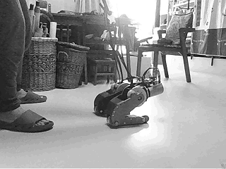
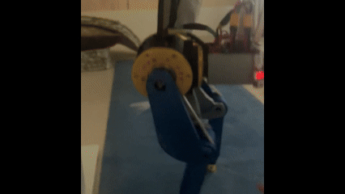
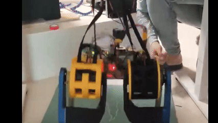
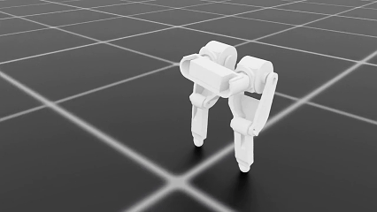
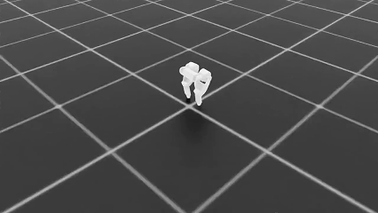
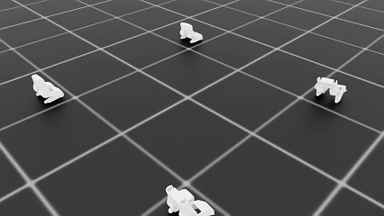
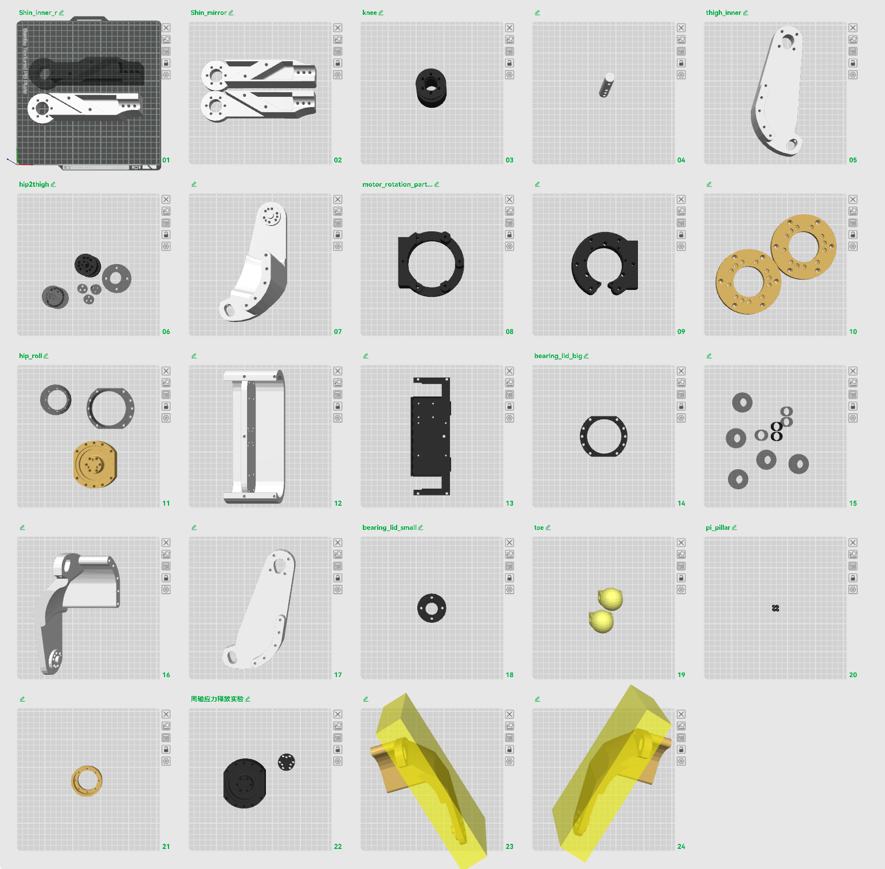

# TipToe



**A ¥5700 point-foot biped, trained with PPO in Isaac Lab, built by one person working
with an AI coding agent. On 2026-10-11 it stood up from a crouch, stepped in place for
43.6 s, and sat back down on command. Two plant corrections closed the sim2real gap; what
stopped the robot after that was a knee belt with no margin. Here is everything,
including what went wrong.**



| Hardware: catch-stepping in place (the "shuffle") | Sim: the released policy balancing in Isaac Lab |
|---|---|
|  |  |
| **Sim: stepping** | **Sim: kneel (seiza) to stand curriculum, never flown on hardware** |
|  |  |

Video: [Bilibili BV1SAh16dEAf](https://www.bilibili.com/video/BV1SAh16dEAf).

TipToe is a 6-DOF biped with no ankles: hip roll, hip pitch and knee per leg,
four RobStride RS01 and two EL05 quasi-direct-drive actuators, a Raspberry Pi 5
running the policy at 100 Hz over CAN, printed structure, and a belt-driven
knee whose motor sits in the hip body (a heron's knee, if you like). Point feet
give no static balance, so the policy has to step reactively, and every
millimetre of centre-of-mass error, degree of IMU bias, or unmodelled
newton-metre in the knee shows up as a fall within a second.

This repository is **open hardware plus an open sim2real research log**. It is
not a platform, and it does not claim to be one. It offers the complete record
from empty repo (2026-03-28) to first stand (2026-09-03) and on to stand-up,
stepping and sit-down (2026-10-11): the plant model, the fix-by-fix record of
what each step took, the pre-registered predictions that were right and the
hypotheses that were wrong — including two the first retrospective credited to
the agent and the second had to reverse — and the mechanical failures that ended
the campaign. The hardware is buildable today; the robot in this repository is
not flyable today, because its knee belt is broken and the replacement is
designed but not built.

## Status (2026-10-19)

| Item | Hardware, from the record |
|---|---|
| **Stands up** from a d = 0.6 crouch (`s11_11880`) | 3/5 on 10-11, 3/3 in a fresh process. Both failures followed a same-process re-arm; the stall behind them was found and fixed on 10-14, not re-flown on a healthy robot. |
| **Steps** in place | 18.9 s and 43.6 s, both ended by a commanded sit. ~66 s of stepping across five trials, one uncommanded fall. For contrast: S8b managed 8.4 s and 8.7 s with two falls on 09-30. |
| **Sits** on command | Yes. The 2.5 s grace sits more cleanly than 1.7 s. |
| **Stands still** | No. It holds a 2.5 Hz limit cycle; S11 cut that band's amplitude by 36–55 % and moved the energy into the 5 Hz harmonic instead. The action sits at the ±1 rail about half the time, and hip_roll heats 26–37 °C per minute of stepping. |
| **Flies** | Not since 10-16. The right knee belt lost 3 of its 7 steel cords, and a fresh belt broke the same way within two trials. The 33:45 / 20 mm / no-idler redesign (same 0.7333 ratio) was decided that day and is not built. |
| **Sim2real** | Closed for this task — the user's verdict (10-19). See below for what the record does and does not show. |
| **Released policy** | `control/r1r_3150.pt`, unchanged: the September policy that stood from a ground start for 6.06 s at the +0.089 trim. |

### What closed it

Two corrections to the plant, both from the user's physical read, are the closing
changes (retrospective II, §2):

1. **The vendor rotor inertia was right.** The plant had been training a robot whose
   legs were ~4.6× heavier in rotor inertia than the motors are
   (19.3e-3 → 4.2e-3 at the output; hip_pitch armature 38.5e-3 → 8.40e-3).
2. **The knee motor's belt reaction on the hip is real.** `plant_hip_reaction`, off
   since 08-06, was turned on: knee torque acts on the hip as +c·τ_knee, c = 0.733.
   A static HOLD crouch had predicted every hip angle within 0.014 rad with no
   fitted parameter.

What the record supports: the policy that stands up, steps and sits is the one trained
on that plant; the static prediction is exact; and the 09-30 and 10-11 flights all ran
at the physically measured trim (−0.015), not the +0.089 the September policy needed.
What it does not support: a same-policy A/B. A policy cannot fly on two plants, the
09-30 contrast is confounded (T0 differed in physics rate, belt model and training
state), and the hip reaction's flight attribution came out inconclusive because six
things changed at once. The closure is a judgement from the record, tagged as such in
retrospective II §6.

### Open problems

1. **The knee drive has no margin.** At the 17 Nm motor clamp the belt sees ~970 N
   against the ~780 N a 5M-10 belt is rated for. The 10-11 idler bought one session;
   it did not fix it. The redesign changes the geometry, and the user suspects the
   printed PLA thigh plate has deformed — nobody has measured by how much.
2. **No quiet stand.** The 2.5 Hz limit cycle is a point-foot problem the reward
   shaping has not touched: the rocking envelope is flat, and hip_roll's thermal budget
   is 1–1.5 minutes of stepping. Nobody knows yet what a still stand would take.
3. **One attribution is still assumed, not measured.** `run_play_S11 -NoHipReaction`
   was prepared and never run; it would turn the closing change from user-attested
   into measured.
4. **Re-establish 10-11 on the rebuilt robot.** Same procedure, n ≥ 3 fresh-process
   stand-ups with crawl-pose tooth checks between trials.

## Who built it

One person and an AI coding agent. The person designed and built the robot,
ran every hardware session, watched the video frame by frame, and supplied
the physical facts and the questions. The agent (Claude Code, and earlier
Claude through the web app) wrote most of the code, the physics derivations
and the analysis, and diffed the two sides of the sim2real gap when they
disagreed. Each retrospective's §3 has its fix-by-fix attribution table —
who noticed, localised, implemented and verified each fix — and the list of the
agent's hypotheses the record proved wrong next to the user's. Part II adds the
two that were reversed: the rotor inertia and the hip reaction. If you are
interested in what agent-driven engineering on a physical robot looks like over
six months, those sections and the nine lessons after them are the reason this
repo is public.

## Build it

- Bill of materials with the prices actually paid: [hardware/BOM.md](hardware/BOM.md).
  Priced lines total about ¥5700 (motors ¥2994, Pi + SD ¥1013, IMU ¥254,
  CAN board ¥40, two 4S packs ¥762, PDB ¥98, hip roll bearings ¥280, belts ¥60,
  print and screws under ¥200).
- Print files: [MakerWorld listing](https://makerworld.com.cn/zh/models/3016996-shuang-zu-ji-qi-ren-tiptoe-y-5700-zi-ping-heng-dia)
  (24 plates, Bambu profiles plus per-part STL). STEP export of the v2.7
  assembly: [GitHub Release v0.1.0](https://github.com/jiz322/tiptoe-biped/releases/tag/v0.1.0).
- Assembly notes, wiring, IMU mounting, motor zeroing: [hardware/ASSEMBLY.md](hardware/ASSEMBLY.md).
- CAN bring-up on the Pi: [control/CAN2SPI_BRINGUP.md](control/CAN2SPI_BRINGUP.md).

**Before you print the knee drive, read this.** The 22:30 HTD 5M-10 belt in this
release is the one that failed on 10-16 — three of seven steel cords, at the 22T
pulley next to the idler added on 10-11. The replacement (33:45 pulleys, a 20 mm
belt, no idler, the same 0.7333 ratio) is designed and not published yet. The
rest of the robot is the one that stood, stepped and sat.



## Run it

On the Pi, in the `control/` folder (torch needed; the campaign used a
miniforge environment, see `docs/ENVIRONMENT.md`):

```sh
sudo ./setup_can0.sh                        # per boot
sudo python3 test_motors.py --no-zero       # all six motors reply, zeros survive
sudo python3 balance_log.py --policy r1r_3150.pt --pg-offset 0.089
# keys: 1/2/3 select group, +/- kp, ]/[ kd, g observe, v blind handover (start), h hold, q quit
```

That is the September reproduction: the released checkpoint and the +0.089 trim it
stood with. Every flight since 09-30 used the physically measured trim (−0.015), and
from 10-11 a different policy and deploy script (`balance_s11.py`, TorchScript with an
embedded contract and fixture). Those are documented in `docs/` and not shipped; the
release ships one checkpoint, `r1r_3150.pt`, and its export.

The recording lands next to the script as `r1r_3150_log_<timestamp>.npz`, in
the schema described in [data/README.md](data/README.md). Desk-side, with no
hardware, `python control/policy_contract_check.py control/r1r_3150.pt`
checks the checkpoint against the deploy observation contract.

## Train it

Isaac Sim 5.1 + Isaac Lab 0.54 (pins in [docs/ENVIRONMENT.md](docs/ENVIRONMENT.md)):

```sh
python -m pip install -e RL/source/RL
# apply the rsl_rl learning-rate-ceiling patch: RL/patches/README.md (required)
RL/launch/play.sh --gpu 0                       # watch the released policy balance
RL/launch/train_S7_fullDR.sh --gpu 0 --headless # the last training recipe
```

Windows equivalents are the `.ps1` files next to them. Details, the three
rules that cost weeks (resumes must re-pass every override; never resume with
a fixed schedule; curriculum advance on relative success), and the sim2real
tools are in [RL/README.md](RL/README.md).

The arms after S7 — S8b's vendor-plant resume, the S9 hip reaction and sit branch, S10
command tracking, S11's long-history encoders, S12's step-length reward — are documented
in `docs/` with their reward terms, A/Bs and verdicts. Their launchers are not in this
tree, and neither are the checkpoints; anything a doc names as `launch_train_S1*` or
`model_*.pt` lives in the private working repo.

## Read it

The docs are the product. In reading order:

| Doc | What |
|---|---|
| [docs/RETROSPECTIVE-2026-10.md](docs/RETROSPECTIVE-2026-10.md) | **Part II (09-05 → 10-19).** The stand-up, stepping and sit campaign; the two plant corrections that closed sim2real; the corrections to Part I; the hardware failures that ended it; who did what. Start here. |
| [docs/RETROSPECTIVE-2026-09.md](docs/RETROSPECTIVE-2026-09.md) | **Part I (03-28 → 09-03).** The six months from empty repo to the first sustained stand: timeline, the 15 fixes with symptom / root cause / verification, who did what, lessons on working with an AI agent on a physical robot. |
| [docs/t0-s8b-flight-analysis-20260930.md](docs/t0-s8b-flight-analysis-20260930.md) | First sustained stepping: S8b at 8.4 s and 8.7 s on the measured trim, against two T0 falls — and why that contrast is confounded. |
| [docs/sit-campaign-plan-20261001.md](docs/sit-campaign-plan-20261001.md) | Sit: run the stand-up path in reverse under the unmodified policy before training anything. |
| [docs/s8b-standup-flight-analysis-20261003.md](docs/s8b-standup-flight-analysis-20261003.md) | First stand-up on hardware: 0/6, tooth skips, and the HOLD pose that revealed the knee's reaction on the hip. |
| [docs/s9-standup-sit-campaign-20261004.md](docs/s9-standup-sit-campaign-20261004.md) | S9: the hip reaction in the plant, α capped, a stand-up speed A/B, and the sit branch that ends in the crouch. |
| [docs/s9-play-review-20261007.md](docs/s9-play-review-20261007.md) | Sim play review: 39 % of spawns put a foot ball under the floor, the reset contract, and settle-before-handover tested and contradicted. |
| [docs/s10-command-tracking-campaign-20261007.md](docs/s10-command-tracking-campaign-20261007.md) | vx and yaw did nothing because their trained ranges sat inside the gait's own noise. Rate vs heading A/B, spawn fixes. |
| [docs/future-campaign-options-20261009.md](docs/future-campaign-options-20261009.md) | What was worth doing after S10, ranked, with the cost of each — including the history-length analysis that became S11. |
| [docs/s11-history-estimator-campaign-20261010.md](docs/s11-history-estimator-campaign-20261010.md) | Long-history 1D-conv encoders with supervised and self-supervised latents, resumed from S10 by zero-column surgery. Pi forward pass 0.60 ms. |
| [docs/s11-flight-analysis-20261012.md](docs/s11-flight-analysis-20261012.md) | 10-11 analysed: 3/5 stand-ups, 18.9 s and 43.6 s with a commanded sit, the re-arm failures, thermal and limit-cycle numbers, 1.8e-6 replay gate. |
| [docs/s12-step-length-campaign-20261012.md](docs/s12-step-length-campaign-20261012.md) | Touchdown step-length reward: one new term, 1.7× the velocity-tracking budget, and the smoke test that justifies it. |
| [docs/flight-runbook-20261014.md](docs/flight-runbook-20261014.md), [docs/flight-analysis-20261014.md](docs/flight-analysis-20261014.md) | 0/10, and why: a sustained yaw the day before nothing turned — traced to loose screws and play in a hip_roll housing. |
| [docs/lowcom-stance-campaign-runbook-20260926.md](docs/lowcom-stance-campaign-runbook-20260926.md), [docs/tline-marchfix-runbook-20260928.md](docs/tline-marchfix-runbook-20260928.md), [docs/flight-prep-20260929.md](docs/flight-prep-20260929.md) | The T-line as written on the day, killed on 09-28 (feet too high, roll shrug), and the 09-30 flight prep and contract diff. |
| [docs/REPO_MAP.md](docs/REPO_MAP.md) | Where everything is, the robot in numbers, the gotchas, the sim2real deployment checklist. |
| [docs/knee-hip-coupling-review-20260821.md](docs/knee-hip-coupling-review-20260821.md) | The belt-coupled knee: the math, how Mini Cheetah avoided it, the sim2real risk ranking. |
| [reports/belt_coupling_sim2real/report.md](reports/belt_coupling_sim2real/report.md) | Does modelling the belt close the gap? Teacher-forcing replay of 7 hardware logs (08-07). |
| [docs/replant-report-20260817.html](docs/replant-report-20260817.html) | Plant identification bench: friction, rotor inertia, coupling, latency verdicts. The plant-parameter source of truth. |
| [docs/imu-sign-check.md](docs/imu-sign-check.md), [docs/PREDICTIONS_p12_3.md](docs/PREDICTIONS_p12_3.md) | How the mirrored IMU signs were certified from a recorded hand manoeuvre; a pre-registered hardware A/B and its scoring. |
| [docs/standup-path-mode-20260908.md](docs/standup-path-mode-20260908.md) | Stand-up redesign: seiza geometry, the balance manifold, the path mode. |
| [docs/s4-stepping-gate-failure-analysis-20260911.md](docs/s4-stepping-gate-failure-analysis-20260911.md), [s4-checkpoint-testing](docs/s4-checkpoint-testing-20260911.md), [s5-elastic-dr](docs/s5-elastic-dr-20260914.md), [armature-derivation-note](docs/armature-derivation-note-20260918.md), [imu-offset-and-joint-zero](docs/imu-offset-and-joint-zero-20260920.md) | The post-stand S line: measured DR, belt elasticity DR, armature from rotor facts, the trim re-measured. |
| [docs/p11-hardware-runbook.md](docs/p11-hardware-runbook.md), [p12-fall-isolation-runbook](docs/p12-fall-isolation-runbook.md), [p12-4-bench-runbook](docs/p12-4-bench-runbook.md), [p9-checkpoint-selection](docs/p9-checkpoint-selection-20260823.md) | Runbooks as written on the day, including the 740-line one that was abandoned and the retracted claims it still carries. |
| [docs/pad-contact-dr-20260912.md](docs/pad-contact-dr-20260912.md) | A contact model that never applied a force (retired 09-17). Kept as a worked example of a knob whose input is never excited. |
| [analysis_motor_filters/](analysis_motor_filters/) | Motor telemetry forensics: the torque feedback is filtered and dead-banded. |
| [docs/v1-postmortem.md](docs/v1-postmortem.md) | April: why the first "balancing" sim policy was a bang-bang hip-roll degenerate. |

## Dataset

Every flight session, one npz per trial at 100 Hz: observations, actions,
targets, joint state, motor torques and temperatures, IMU, loop timing. Nine
sessions, 69 trials, 2026-08-24 to 09-10, including the 6.06 s and 8.79 s
stands. Released as zips on the [v0.1.0 Release page](https://github.com/jiz322/tiptoe-biped/releases/tag/v0.1.0)
under CC BY 4.0; the schema, the per-session contracts (trim, handover, IMU sign
state) and a loader snippet are in [data/README.md](data/README.md).

Six later sessions (09-30 → 10-16, 27 flight trials) are also in `data/`, with the
contract each was flown under and the figures the analyses produced: the 8.4/8.7 s
stepping runs, the 0/6 stand-ups, the 10-11 stand-up/step/sit flight, the 0/10
regression and the belt failure. Their recordings, and the per-flight scripts that
read them, are not in a release yet; the per-folder `README.txt` is the flight record,
written on the day.

## Layout

```
hardware/    BOM, assembly notes            control/   deploy stack + released checkpoint
assets/      URDF, meshes, USD (v2.7)       RL/        Isaac Lab task, launchers, patch
docs/        reports, runbooks, figs/       data/      analysis, session contracts, figures
script/      Isaac Sim pose viewers         legacy/    every launch script, old phases, pre-RL
reports/, analysis_motor_filters/           concluded bench studies with figures
```

`big_thigh` in the docs and code is the project's internal codename.

## Licensing

- Code: MIT ([LICENSE](LICENSE)). `RL/source/RL` retains the Isaac Lab
  template's BSD-3-Clause notices.
- Hardware (URDF, meshes, CAD, print files), documents, reports and the
  dataset: CC BY 4.0 ([LICENSE-CC-BY-4.0](LICENSE-CC-BY-4.0)).
- RobStride protocol documents are not redistributed; get them from the vendor.

## Contributing and citation

No support is promised; replication reports are read first. See
[CONTRIBUTING.md](CONTRIBUTING.md). Cite with [CITATION.cff](CITATION.cff).
