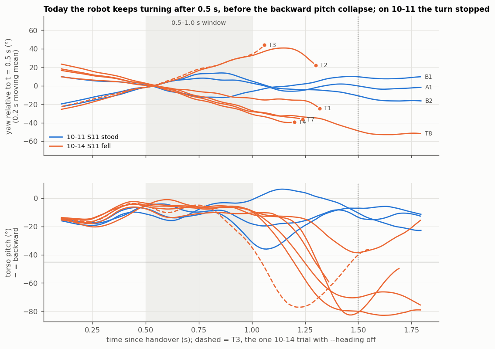
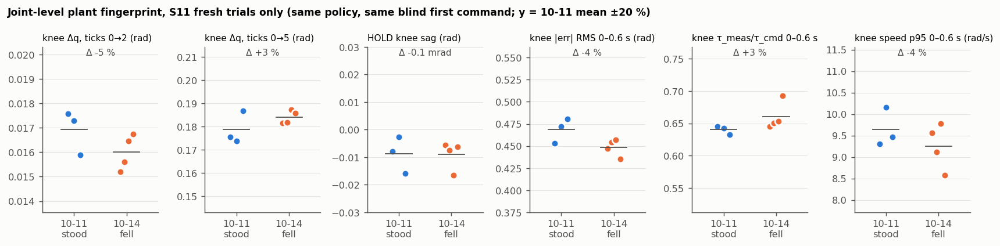
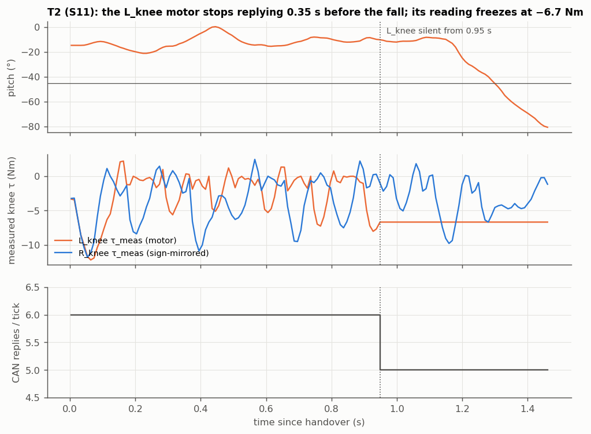

# Flight analysis: 2026-10-14 (S11 ×6, S10b ×1, S12 ×1), analysed the same day

**Data:** `data/flight_20261014/hw/` (8 trials plus the Pi dry run 142311). The deploy code as run is in
`data/flight_20261014/asrun/` (pulled from the Pi). **Scripts:** `_common14.py`, `_diag.py`, `_late.py`, `_obsdiff.py`,
`_yaw.py`, `_yaw2.py`, `_figs.py` (each writes a `_*.json`; figures in `figs/`). **References:** the 10-11 trials in
`data/s11_flight_20261011/`. **Runbook:** `docs/flight-runbook-20261014.md`.

**User account (ground truth):** no trial stood up, and all failed quickly. S10b was the most violent. Unlike 10-11,
**it did not stand even with the user's help on the tether**, and tightening the belt did not fix it (corrected 10-15: it helped partly). The user's
reading of 10-11 is that fresh trials stood every time (excluding the stall-bug trials). User hypotheses: belt/pulley
friction got worse; the bus voltage was higher.

**User corrections (10-15, ground truth):** (a) the floor contact is ruled out: the feet wear the same chair-leg
silicone anti-slip caps as on the successful flights (μ ≈ 0.6–1, inside the training band). (b) Belt tightening
**helped somewhat**: with the belt at its tightest the robot *almost* stood. (c) The 10-15 hardware inspection found
**loose screws in many places** and a hip_roll motor with play at the seam of its housing; the R_roll motor (106) was
replaced with a new EL05. §7 is revised accordingly.

So something changed systematically between 10-11 and 10-14. This analysis looks for what changed.

## 1. Trials

| id | file | policy | heading | outcome | pitch past −45° |
|---|---|---|---|---|---|
| T1 | 144055 | s11_11880 | hold | fell backward | 1.32 s |
| T2 | 144204 | s11_11880 | hold | fell backward; **L_knee motor stopped replying at 0.95 s** (§5) | 1.30 s |
| T3 | 145153 | s11_11880 | **off** | fell backward | 1.06 s |
| T4 | 150836 | s11_11880 | hold | fell backward | 1.20 s |
| T5 | 151126 | s10b_12179 | hold | fell backward and sideways | 1.29 s |
| T6 | 151500 | s12_13010 | hold | fell backward and sideways | 0.74 s |
| T7 | 153118 | s11_11880 | hold | fell backward | 1.24 s |
| T8 | 153200 | s11_11880 | hold | pitch to −40° at 1.5 s, then +34° forward (help) — the closest of the recorded trials | — |
| T9 | 155042 | s11_11880 | hold | fell backward, rolled to −77° (copied 10-15, not in §2–§6) | 1.12 s |
| T10 | 155450 | s11_11880 | **off** | fell backward (copied 10-15, not in §2–§6) | 1.18 s |

The re-arm fix works: `time[0]` is 3.9–5.1 ms and the max tick 11.7 ms in every trial.

## 2. The discriminating signal: the robot keeps turning after 0.5 s (found after the fact)

On **both days** the robot turns 20–40° during the first 0.5 s of the stand-up. **On 10-11 the turn stopped at about
0.6 s. Today it keeps going in the same direction** until the robot falls backward.

| | net yaw 0.5 → 1.0 s | yaw oscillation \|ω_z\| 0.5–1.0 s |
|---|---|---|
| 10-11 stood: A1 / B1 / B2 | +6.7° / −4.2° / +3.8° | 62 / 73 / 83 °/s |
| 10-14 S11: T1 / T2 / T3 / T4 / T7 / T8 | −15 / +37 / +35 / −30 / −26 / −30° | 59–82 °/s |

- **Separation:** all six of today's S11 trials exceed all three 10-11 stand-ups (exact one-sided rank test p = 1/84 ≈ 0.012).
  The yaw *oscillation* from stepping is unchanged. What's new is a sustained turn on top of it.
- **Order of events:** yaw passes 40° 0.3–0.6 s before pitch passes −30° in T2, T3, T4, T7 and T8. (T1 crosses
  both at about the same time.) On 10-11, **B2** shows the same start (40° at 0.80 s, pitch −30° at 0.98 s) and was one
  of the user-helped trials. The pitch collapse is the end of this sequence, not its start.
- **Direction:** the turn goes both ways (4 negative, 2 positive). A single weak leg, knee or belt would push it the
  same way every time.
- Pitch, knee and hip trajectories overlap with the 10-11 stand-ups until ~0.8 s
  (`figs/standup_vs_1011.png`). After that the backward travel isn't stopped: the estimator's v_x (unvalidated)
  reaches −0.8…−1.1 m/s where A1 returned to 0.
- This signal was found by searching the data, not pre-registered. §7 pre-registers the test.

## 3. What did not change

| candidate | verdict | discriminating signal |
|---|---|---|
| **Motors / belt friction** (user 1) | **contradicted** at the motor | S11 trials receive a bit-identical first command (knee 12.5 → 17.0 → 14.2 Nm motor-side on both days). Over 0–0.6 s the knee response matches within ±5 % with mixed sign (`_fingerprint.json`): first-tick motion −5 % / +3 %, tracking error −4 %, HOLD sag −0.1 mrad, speed −4 %. That excludes a friction change above roughly 1 Nm joint-side. (Belt tightening did help partly, per the 10-15 correction. That points at play after the encoder, not at motor friction.) |
| **Bus voltage** (user 1) | **contradicted** as an actuation change | MIT torque is current-controlled. Higher voltage would show as more motion for the same command; it shows −4 % speed. Voltage isn't logged |
| belt stretch/slip (doesn't load the motor) | **cannot test from npz** | motor-side derived joints (checklist item 9). The yaw going both ways argues against one degraded belt |
| **Deploy code** | **contradicted as the cause** | the diff vs 10-11 (`asrun/`) is GC freeze, next-tick arming, and heading hold (§4). T3 ran `--heading off`, which is the 10-11 configuration, and fell first (1.06 s) with the same sustained turn |
| yaw sign reversed | **contradicted** | yaw rate vs gyro ω_z: corr +0.93…+0.98, slope 0.96–1.03 in every S11 trial |
| start state | **contradicted** | pre-roll crouch pitch −14.3…−15.7° (10-11: −14.3…−16.7°), joints within 0.05 rad of rest, gyro std identical |
| IMU loosened (vibration) | **contradicted** | > 20 Hz content of gyro, knee/hip velocity and pg_x is inside the 10-11 range (`_obsdiff.py`) |
| what the policy sees, 0.1–0.8 s | only 2 of 36 channels separate the days: lower ω_z std and lower L-knee velocity std today | no offset or noise change in any channel, apart from the heading channels in hold mode (§4) |

## 4. Heading hold feeds a large heading error *during* the stand-up (a deploy issue, not the cause)

With `--heading hold` (the 10-14 default) the yaw-error channels obs[34:36] are live during grace. Today's turn
therefore reaches the policy as an error of 26–65° at 1.0 s (T7: 45° → 78° at 1.4 s). With `off` (every 10-11 trial)
they were a constant (0, 1). Training feeds current yaw − spawn yaw during grace too, so `hold` matches the training
contract. But a 30–60° stand-up turn is very likely beyond anything the policy saw in sim (sim yaw during
stand-up is not logged). The 60° trip guard only runs once commands are active, not during grace. T3 (`off`) fell
the same way, so this is not what changed today. It is an uncontrolled variable in 7 of 8 trials and should be taken
out: `--heading off` until hold is re-anchored at `cmd_active`, which the deploy already does at grace expiry.

## 5. T2: the L_knee motor stopped replying 0.35 s before the fall

Replies drop to 5/6 from 0.949 s to the end. The L_knee measured torque freezes at −6.7 Nm, and tick time rises
~1 ms because of the reply timeout. On 10-11 (B3) it was the **R_knee**. The driver keeps the last state, so the
policy was fed a stale knee from 0.95 s. Nothing in the reply as decoded shows whether the motor kept actuating.
**As the cause of T2's fall: inconclusive.** T2 was already turning (+37° net by 1.0 s) like the others. **As a
hardware fault: real.** Two different knee motors, both during hard motion, points to the harness or the power side
rather than one connector.

## 6. S10b / S12, and the runbook checks

S10b is the most violent, as observed. Knee motor-τ p95 is 16.6 Nm (S11 11.2–14.2 Nm), knee clamp time 0.11 s (S11
0.01–0.03 s), and the action is on a rail 96 % of ticks. **S10b and S12 also lean −20…−30° in roll** from ~0.4 s,
driven by the right hip_roll, which no S11 trial does on either day. S12 holds its hips flexed and falls first
(0.74 s). n = 1 each.

| id (runbook §6) | verdict |
|---|---|
| F1 re-arm fix | **supported** (t0 ≤ 5.1 ms, max tick 11.7 ms) |
| H1 heading hold | **inconclusive**: never reached commands standing (§4 is a separate grace-time finding) |
| H2 policies equivalent | **inconclusive** for stand-up count (0/6, 0/1, 0/1); S10b/S12 move differently (roll lean) |
| H3 supine sign | **not run** (the dry log is upright on the stand) |

## 7. Leading candidate and the test that decides it

*Revised 10-15.* The first version named foot–floor traction. The user ruled it out (same silicone caps as the
successful flights), and the claim it rested on, "belt tightening doesn't help", was also wrong. Traction is withdrawn.

**Leading candidate: mechanical looseness in the legs** (loose screws in many places; hip_roll housing play), found
at the 10-15 inspection. It fits the evidence:

- **Motor-side response unchanged (§3):** play in the structure or the belt sits *after* the encoders, so the npz
  can't see it (checklist item 9). That is why every motor-side fingerprint matched.
- **A tighter belt helped partly:** it removes one source of play but not the loose screws.
- **The turn grows after 0.5 s and goes either way:** play at the hip lets the stance leg twist about vertical
  under load, with no preferred side.
- **T9 / T10** (copied 10-15) repeat the pattern: net yaw 0.5 → 1.0 s +24° / −16°, backward fall at 1.1–1.2 s,
  T10 with heading off. That makes 8 of 8 recorded S11 trials ≥ 15°.

Untested: nothing logged measures play. The hardware was repaired before the test, so the test can only show
whether the repair restores the 10-11 behaviour. It can't say which part did it (screws, the new R_roll motor and the
belt all changed together).

**Test, pre-registered for the 10-15 flight:** S11, `--heading off`, 3 fresh trials after the repair.
- **Supported:** net yaw over 0.5 → 1.0 s ≤ 10° in ≥ 2 of 3, and they stand.
- **Contradicted:** net yaw ≥ 15° in ≥ 2 of 3 with backward falls. Then the knee harness (§5) and belt-tooth state
  are next.
- **Inconclusive:** anything else, or the user helps before 1.0 s.

## 8. Other items (the user decides; costs are estimates)

| item | answers | cost |
|---|---|---|
| Crawl-pose tooth check after today's falls | belt integrity | user, 2 min |
| Wiggle-test the knee harness with the reply count on the display | §5 | user, bench |
| Log per-motor reply flags plus any status bits in the RS01 MIT reply; read the bus-voltage and fault registers in HOLD before and after each trial | separates "reply lost" from "motor dropped out"; measures voltage | ~1 h, standard practice |
| Play-side logger for sim yaw and root velocity during stand-up | is a 30–60° stand-up turn (and the §4 heading error) in distribution? | 30–45 min + one GPU run |
