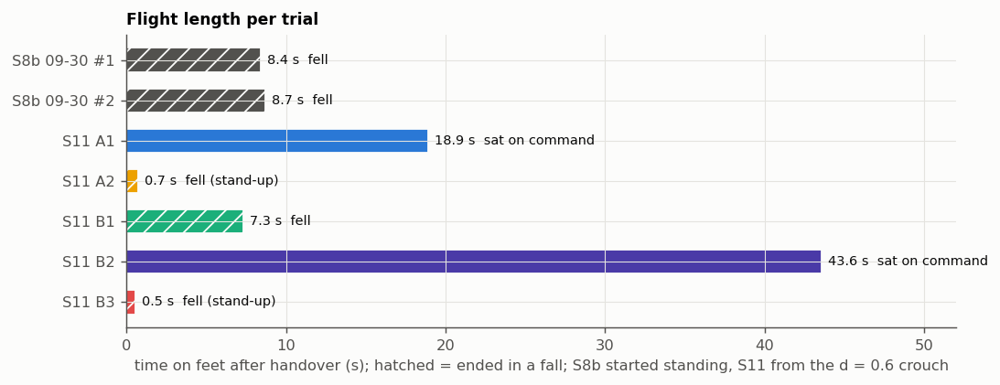
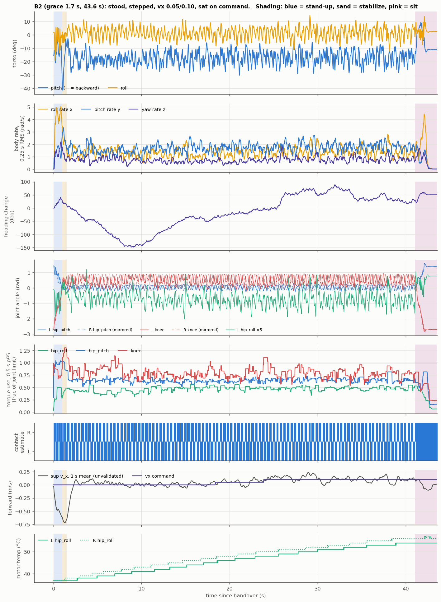
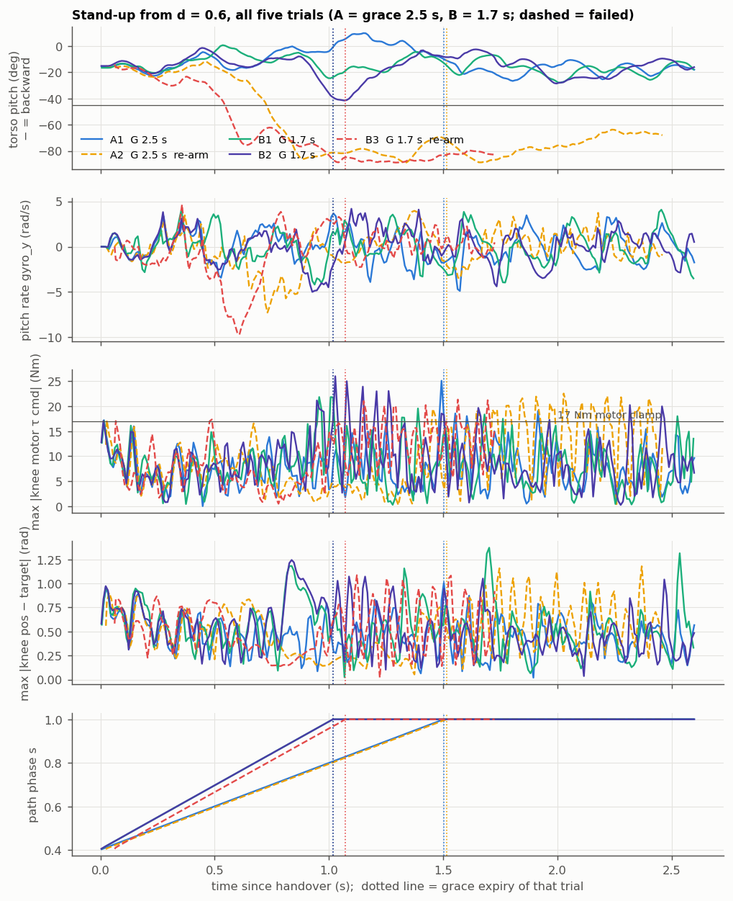
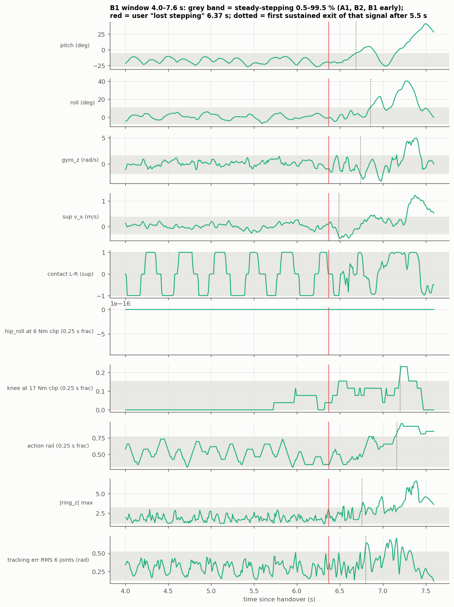
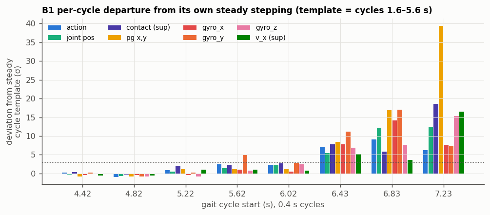
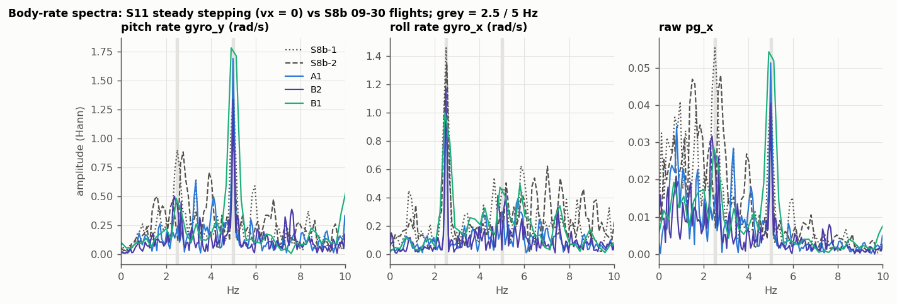
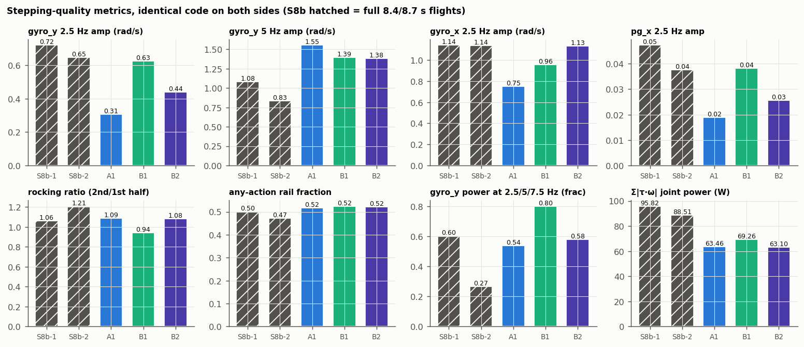
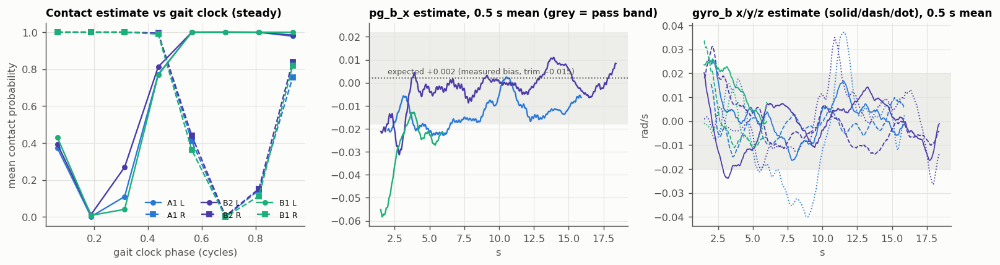
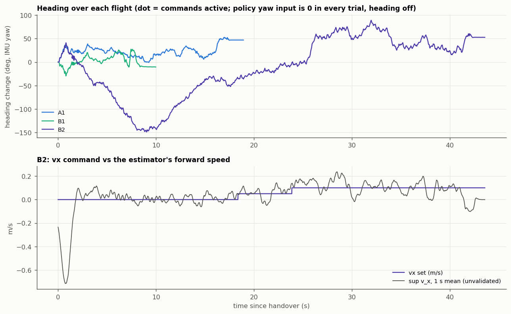
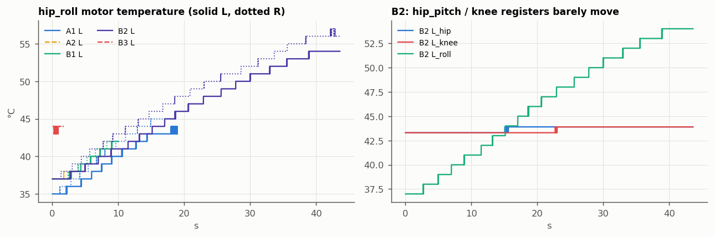

# S11 flight analysis — 2026-10-11 flights, analysed 2026-10-12

**Data:** `data/s11_flight_20261011/` (5 trials, as-run deploy code, README with the user's 10-12 video notes).
**Policy:** `control/s11_11880.ts.pt` (S11_hist model_11880), blind handover, trim −0.015, d = 0.6 crouch stand-up,
`--heading off`. **Runbook executed:** `docs/s11-flight-analysis-runbook-20261012.md` (hypotheses and bars are
quoted from it, unchanged). **Scripts:** `data/s11_flight_20261011/_*.py`, each writes a `_*.json` summary;
figures in `data/s11_flight_20261011/figs/`.

**Ground truth used (user, 10-12):** "6.37 s" is npz time (counted from launch, roughly accurate). A2 and B3
"charged backward as usual, the torso pitched backward too far, fell backward". B1 "looked like it lost power
for a span". Tether-taut frames and floor displacement were not provided (judged too rough, low importance).
Heading over the stand-still windows "should be small" — derived from data below.

---

## 1. What the robot does on hardware (first full performance summary)



| | S8b 09-30 (2 flights, standing start) | S11 10-11 (5 trials, crouch start) |
|---|---|---|
| stand-ups | — | **3 / 5** (3/3 in a fresh process, 0/2 after a same-process re-arm) |
| time on feet | 8.4 s, 8.7 s, both fell | A1 18.9 s and B2 43.6 s, **both ended by a commanded sit**; B1 fell at ~7.3 s |
| total stepping time / uncommanded falls | 17 s / 2 | **~66 s / 1** |
| stand-up duration (grace + stabilize) | — | 2.0 s (A, G 2.5) / 1.5 s (B, G 1.7) |
| torso pitch while stepping, mean (p5…p95) | −17° (−29…−4) | −17.5° (−25…−10) — **band ~40 % narrower** |
| roll RMS | 5.3–5.4° | 3.7–3.8° |
| body-rate RMS pitch / roll / yaw (rad/s) | 1.9 / 1.9 / 1.0 | 1.7 / 1.3 / 0.6–0.7 |
| yaw rate p95 | 113–129 °/s | 66–81 °/s |
| hip_pitch / knee tracking error RMS | 0.48–0.54 rad | 0.31–0.40 rad |
| torque use p95 (frac of joint limit) hip_roll / hip_pitch / knee | 0.47 / 0.65 / 0.87 | 0.45 / 0.62 / 0.71–0.86 |
| Σ\|τ·ω\| joint power | 89–96 W | 63–69 W |
| action at ±1 rail (any joint) | 0.47–0.50 | 0.52 |
| gait (estimator, unvalidated) | — | 2.5 Hz clock, stance duty 65–68 % per foot, double support 31–36 %, no flight phase |
| compute | — | tick busy p50 3.1 ms, p99 ≤ 5.8 ms, max 9.1 ms (excluding the two re-arm stalls) |
| hip_roll temperature | — | **+26 to +37 °C per minute** of stepping (B2: 37 → 54/56 °C in 43 s) |

The per-flight views are `figs/overview_A1.png`, `overview_B1.png` and `overview_B2.png`: pitch and roll, body
rates, heading, joint angles, torque use, contact estimate, speed estimate and temperature on one time axis.



---

## 2. Gate (§4.0): the logs are what the policy saw — PASS

Replaying the logged `obs` stack plus the rebuilt 250×24 ring through the TorchScript reproduces the logged
action to **max |Δ| 1.4e-6** and `sup` to **1.8e-6** on all 5 trials (`_gate_replay.json`). `hist_frame` equals its
obs slice exactly, and `ring_first_tick` equals the prime frame. Tick Δt median is 10.04 ms, and no interval
exceeds 12.5 ms. CAN: 6/6 replies on every tick, except **B3, where R_knee stopped replying from 0.87 s to the
end (86 of 167 ticks)**. By 0.87 s B3 was already past −70° pitch, so this is downstream of the fall; it still
warrants a cable check.

---

## 3. Re-arm failures A2 and B3 (§4.1)



Both failures go past −45° backward **during** grace: A2 at 0.73 s and B3 at 0.55 s. Both happen at path phase
s ≈ 0.7, the hip-extension segment. The video agrees: both fell backward.

**The discriminating signal is in the first control interval.** In every trial the knee motion between tick 0
and tick 2 is the motion executed under the blind first command, which is knee +0.42 rad and identical in all 5
trials:

| trial | first-tick stall (t of tick 0) | knee Δq over the first interval | gyro_y at tick 1 |
|---|---|---|---|
| A1 / B1 / B2 (fresh) | 3.9–6.1 ms | 0.016–0.018 rad | ±0.002 rad/s |
| A2 (re-arm) | 23.9 ms | 0.056 rad (3.3×) | −0.14 rad/s |
| **B3 (re-arm)** | **62.0 ms** | **0.137 rad (8×)** | **−1.43 rad/s (pitching backward)** |

The stall therefore falls **after** `send_target` on tick 0. The robot executes the blind first action open-loop
for 24 / 62 ms instead of 10 ms. If the stall sat before the send, the robot would just hold its HOLD pose longer
and the first-interval motion would be normal. The stall length still tracks the previous run's log length; GC
is the leading suspect, but the cause of the stall itself is untested.

Tick-aligned divergence from the same-grace fresh trials (`_standup.json`; rule: > max(2 × B1–B2 spread, floor)
for 5 ticks):
- **B3:** diverges at tick 1–2 on gyro_y and both knees, and on pitch at tick 16. It never rejoins.
- **A2:** tracks A1 within ±4° pitch until ~0.45 s. It diverges at ticks 47–65 (knee R, gyro_y, pitch).

| id | verdict | discriminating signal |
|---|---|---|
| R1 deploy state not reset | **contradicted** | t = 0 obs, ring, tail, action and filtered action are bit-identical in all 5 trials; `to_hold`/`start_run` zero every filter, as `_reset_idx` does |
| R1b state outside the script persists | **contradicted** | t = 0 joint velocity, pre-roll gyro mean/std, pg jump at handover and pre-roll pose all sit inside the fresh spread (B1 is fresh and has the second-largest t0 joint velocity) |
| R2 first-tick stall sends lift-off off-script | **supported for B3**; **contradicted for A2** | B3: 8× first-interval knee motion and −1.43 rad/s at tick 1, divergence from tick 1. A2: the 3× kick is absorbed and the trajectory stays with A1 until ~0.45 s, past the pre-registered 0.2 s |
| R3 thermal | **contradicted** | knee tracking-error RMS during grace is 0.39 (A2) / 0.43 (B3), inside or below the fresh 0.42–0.54 |
| R4 handling (tether) | **inconclusive** | no tether frames from video (user: too rough). A2 was reported pulled. Nothing in the npz separates a pull from the policy's own backward fall |
| R5 chance | **open for A2** | A2's divergence at ~0.5 s has no deploy-side explanation; tether and chance remain |

**Fix** (the user decides; ~5 lines): call `gc.collect()` inside `to_hold()` and `gc.freeze()` after start-up,
or pre-allocate the log buffer. The stronger form also guards the contract directly: whatever stalls, tick 0's
command must not be held longer than one period. Until then, **one fresh process per trial** (it worked 3/3).

---

## 4. B1: the stepping rhythm broke at ~6.4 s, then the robot fell forward (§4.2)




The `sup` contact estimate alternates cleanly through 6.35 s and turns erratic in the 6.43 s gait cycle. That
matches the user's 6.37 s. Every channel then leaves its steady band together in the 6.43 s cycle (action +7σ,
contact +8σ, pg +8σ, gyro_y +11σ vs B1's own 1.6–5.6 s cycle template). The robot falls **forward** at ~7.3 s
(pitch to +37°, roll excursion to +40°).

The only earlier signal is **pitch-rate amplitude**. gyro_y is +4.9σ in the 5.6 s cycle and +2.9σ in the 6.0 s
cycle. The knee reaches its 17 Nm clamp for the first time in steady stepping at 5.7 s, within band.

"Lost power for a span" is **not an actuator or communication dropout**. Ticks stay 9.6–10.5 ms, CAN is 6/6 on
every tick, gains and torque caps never change, and the per-motor torque delivery ratio is normal through 6.5 s.
It drops only during the 7.0–8.0 s collapse.

| id | verdict | signal |
|---|---|---|
| B-a contact loss | **co-leading, unvalidated channel** | contact rhythm breaks in the 6.43 s cycle together with everything else. No video contact frames to validate `sup` |
| B-b saturation | **contradicted** | hip_roll never reaches its 6 Nm clip in any trial; knee 17 Nm clip fraction stays in band until 7.2 s |
| B-c velocity run-away | **contradicted as leader** | `sup` v_x is in band until 6.49 s, after the break |
| B-d lateral | **contradicted as leader** | roll exits at 6.86 s, gyro_x at 6.81 s |
| B-e out-of-distribution input | **contradicted as leader** | ring \|z\| exits at 6.76 s |
| B-f external | **inconclusive** for tether; **contradicted** for a deploy/motor power loss | see the telemetry facts above |

**Verdict:** no deploy or plant fault leads. The failure develops inside the policy's own limit cycle: pitch-rate
amplitude grows for two cycles (5.6–6.4 s), then the rhythm collapses. The root cause is **inconclusive**.

---

## 5. Stepping stability vs S8b (§4.3)




Both sides are computed by the same code (`_stepping.py`). It reproduces the 09-30 doc's S8b pitch range
(−39.2…+6.4) and rail fractions (0.50 / 0.16 / 0.16 / 0.08) exactly. Its spectral amplitudes come out somewhat
below the doc's (gyro_y 0.72 vs 0.86), a difference in window and segment, so only same-code numbers are
compared. S11 windows are steady stepping at vx = 0 (A1 2–15.9 s, B2 1.5–18.4 s, B1 1.5–6.0 s).

| metric | S8b #1 / #2 | A1 | B2 | B1 |
|---|---|---|---|---|
| gyro_y 2.5 Hz amplitude | 0.72 / 0.65 | 0.31 (−55 %) | 0.44 (−36 %) | 0.63 (−8 %) |
| pg_x 2.5 Hz amplitude | 0.047 / 0.038 | 0.019 (−55 %) | 0.026 (−39 %) | 0.038 (−11 %) |
| gyro_y **5 Hz** amplitude | 1.08 / 0.83 | **1.55** | **1.38** | **1.39** |
| gyro_x 2.5 Hz amplitude | 1.14 / 1.14 | 0.75 | 1.13 | 0.96 |
| rocking ratio (2nd / 1st half) | 1.06 / 1.21 | 1.09 | 1.08 | 0.94 |
| any-action rail | 0.50 / 0.47 | 0.52 | 0.52 | 0.53 |

| id | verdict | signal |
|---|---|---|
| (a) "more stable": 2.5 Hz amplitude ≥ 30 % lower **and** rocking ratio ≤ 1.0 | **inconclusive (mixed)**: neither bar met as a pair | the 2.5 Hz band dropped 36–55 % in A1/B2, but the rocking ratio is 1.08–1.09 over 14–17 s: a flat, non-decaying envelope, not a decaying one. Not contradicted either (the amplitude is not within ±15 %) |

**What did improve:** survival (~66 s of stepping with 1 fall vs 17 s with 2), the pitch band (~40 % narrower),
lateral motion (roll RMS −30 %), yaw rate (−40 %), joint tracking error (−30 %) and joint power (−30 %).

**What did not:** the action is still at the rail half the time, the limit cycle is still there (flat envelope),
and the pitch-rate energy moved from 2.5 Hz to its 5 Hz harmonic (+45–65 %).

I also tested, without pre-registration, whether S11's gait is more periodic: harmonic power fraction on matched
8 s windows is 0.65 / 0.66 vs S8b 0.60 / 0.27. The result is mixed, so no claim is made.

**(b) Attribution to hip_reaction: inconclusive from flight data**, as pre-registered. S8b → S11 changed six
things, including the idler pulley (0 tooth skips today). The sim dependence test is prepared in §12.

**(c) HOLD-pose plant match: not run** (needs the sim settle, §12). Hardware side for that comparison: pre-roll
HOLD hip_pitch is 1.418–1.434 rad against target 1.321. The HOLD error (hip 0.10, knee 0.154 rad) equals 10-03's
(0.10 / 0.153).

---

## 6. Stand-up speed 2.5 s vs 1.7 s, and backward travel (§4.4, §4.5)

| trial | G | pitch min in grace | pitch at grace end | knee 17 Nm clamp time in grace | knee peak | rail fraction in grace | outcome |
|---|---|---|---|---|---|---|---|
| A1 | 2.5 | −22.8° | **−10°** | 0.050 s | 25.1 Nm | 0.82 | stood |
| B1 | 1.7 | −24.6° | −24° | 0.050 s | 21.8 Nm | 0.90 | stood |
| B2 | 1.7 | −39.2° | **−39°** (then recovered) | 0.060 s | 21.1 Nm | 0.93 | stood |
| A2 | 2.5 | −89° | −72° | 0.024 s | 19.4 Nm | 0.98 | fell back |
| B3 | 1.7 | −89° | −85° | 0.025 s | 17.3 Nm | 0.94 | fell back |

| id | verdict | signal |
|---|---|---|
| G1 the 1.7 s stand-up loads the knee clamp more | **contradicted** | clamp time in grace: B1 / B2 0.050 / 0.060 s vs A1 0.050 s (within ±20 %); peak lower in B |
| G2 sim success at 1.667 s ≥ 0.05 below the 2.5–3.0 plateau | **not run** | `eval_alpha_success.py` needs a hist-actor edit (~30 min, §12) |
| BW1 backward travel is the trained strategy / BW2 plant gap / neither | **inconclusive** | no floor displacement (video) and no sim root log. The `sup` estimate integrates to −0.44 m (A1), −0.61 (B1), −0.90 (B2) over stand-up + stabilize and peaks at −0.7 m/s, but `sup` v_x is unvalidated |

The user's impression that "1.7 s looks worse" shows up as **pitch, not knee load**. Both 1.7 s stand-ups end
grace pitched 14–29° further backward than A1, and B2 at −39° came close to the region where A2 and B3 were lost.
With n = 1 vs 2 and help on the tether reported in B1/B2, this is a direction, not a ranking. **Next flight:
grace 2.5 s** until the sim rate curve exists.

---

## 7. The S11 estimator (`sup`) on real data (§4.6)



| group | bar (runbook) | result | verdict |
|---|---|---|---|
| gyro_b | \|mean\| ≤ 0.02 rad/s steady | steady means ≤ 0.014 rad/s (B1 x); 1 s means wander to ±0.036 | **pass** on means |
| pg_b_x | \|pg_b_x − 0.002\| ≤ 0.02 | A1 −0.013 (pass), B2 −0.003 (pass), B1 −0.029 (fail). Reads −0.02 to −0.06 right after stand-up and drifts toward 0 over ~10 s | **2/3 pass**; time-varying, so not a stable bias reading |
| jb | report only | hip_roll ±0.02 rad, mirror-symmetric (L +0.022, R −0.020…−0.025) in all 3 flights; hip_pitch / knee \|jb\| ≤ 0.014 rad | gives no support to the 09-20 knee/hip joint-zero branch (weakly observable channel) |
| contact L/R | video stance frames | no video frames. Plausibility: locked to the gait clock, duty 0.65–0.68, double support 0.31–0.36 | **inconclusive** |
| v_x, vs_x | video displacement | no video displacement. B2's estimate is correctly ordered for commands 0 / 0.05 / 0.10 → 0.019 / 0.060 / 0.114 m/s | **inconclusive** |

**P-hw (offline predictor skill): not built** (3–4 h; build list in §12).

---

## 8. Heading, idle drift and command tracking (§4.7, §4.8)



The policy's yaw input was **0 on every tick of every trial** (ch33 = 0, sin(yaw_err) = 0, `heading_mode off`).
IMU yaw matches the integrated body gyro_z (B2 −47 vs −48°, B1 +23 vs +23°), and pre-roll gyro bias is ~1e-4 rad/s,
so the headings below are real rotation, not drift.

| window (vx = 0) | net heading change | range | 2 s yaw rate \|median\| |
|---|---|---|---|
| A1 2.0–15.9 s | **−3°** | −23…+16° | 4.3 °/s |
| B1 1.5–6.0 s | +23° | −2…+24° | 2.3 °/s |
| B2 1.5–18.4 s | −47° | **−160…0°** | **19 °/s** |

The user expected a small heading change. **A1 confirms that** (net −3°, ±20° wander). **B2 contradicts it:** a
−160° excursion and back within the vx = 0 window.

| id | verdict | signal |
|---|---|---|
| idle drift ≤ 0.15 m / 10 s (supported) vs > 0.4 (contradicted) | **inconclusive** | no video displacement. Unvalidated proxy ∫`sup` v_x: 0.21 m / 10 s (A1), 0.18 (B2) |
| Y1 `a`/`d` reached the policy | **contradicted** | as-run code refuses `a`/`d` in off mode; logged ch33 and yaw_err are exactly 0 |
| Y2 tether / handling | **inconclusive** | no tether frames (user reported helping in B2) |
| Y3 the policy wanders on its own; B2 just ran longer | **contradicted** | B2's 2 s yaw-rate median 19 °/s vs 4.3 / 2.3 in A1 / B1 over the same window lengths |
| Y4 foot pivot | **inconclusive** | needs video |
| vx "works" (0 < 0.05 < 0.10, \|err at 0.10\| ≤ 0.08) | **inconclusive** | needs video speed. The estimator's own speeds are ordered correctly, which is not independent evidence |

Added signal: in B2, the 2 s yaw rate correlates with the policy's hip_roll target sum (L + R) at **r = −0.92**
(15 windows, vx = 0; −0.71 over the whole flight). The turning is expressed through the policy's own hip-roll
asymmetry. Whether the policy generates it or answers an external yaw torque (the tether) cannot be told from
the npz.

---

## 9. Thermal budget and idler friction (§4.9)



- **hip_roll heats at 26–37 °C/min** while stepping. Mean \|τ\| is 1.0–1.2 Nm (p95 0.45 of 6 Nm), and the 6 Nm
  clip is never reached. Linear extrapolation from B2's end (54/56 °C) gives 60 °C in 9–14 s, 70 °C in 31–36 s and
  80 °C in 52–59 s. That makes **~1–1.5 min of continuous stepping from a 37 °C start** the current budget. The
  vendor derating temperature is still needed (vendor GUI) to set the cap.
- **The knee and hip_pitch temperature registers barely refresh:** 1–2 distinct values per trial (0.6 °C quantum,
  40.6 / 43.3 / 43.9 °C). Treat them as untrusted.
- **F1 (idler adds knee friction): contradicted.** Steady HOLD knee error is 0.139–0.165 rad (mean 0.154) today
  vs 0.133–0.174 (mean 0.153) on 10-03, at the same kp 30. That is within ±15 %.

---

## 10. Added finding: the pitch sign convention in earlier docs is reversed

The 09-30 and 10-03 docs label **negative raw pg_x as "forward"**. That label was an assumed convention (10-03
doc line 64), never tied to video. Today's two video-called **backward** falls end at pg_x **−0.93 / −0.99**. Two
other facts point the same way. For a body frame with x forward, standard projected gravity gives pg_x < 0 when
leaning backward. And the `sup` v_x is negative during the stand-up travel the user sees as backward.

This analysis therefore uses **negative pitch = torso tilted backward**. Under it, the S8b 09-30 "forward-lean
operating point" and the 10-03 "forward falls" would be backward, and vice versa. One supine/prone bench reading
closes it: lying on its back, the robot should read raw pg_x ≈ −1. Until that check is done, any older doc that
names a fore/aft direction should be read with this caveat.

---

## 11. Verdict table (single pass, every pre-registered id)

| block | id | verdict |
|---|---|---|
| 4.0 | log integrity / bit-exact replay | **pass** (1.4e-6 / 1.8e-6) |
| 4.1 | R1 / R1b / R2 / R3 / R4 / R5 | contradicted / contradicted / **supported (B3), contradicted (A2)** / contradicted / inconclusive / open (A2) |
| 4.2 | B-a / B-b / B-c / B-d / B-e / B-f | co-leading (unvalidated) / contradicted / contradicted / contradicted / contradicted / power loss contradicted, tether inconclusive. Earliest signal: gyro_y amplitude, 5.6 s cycle |
| 4.3 | (a) more stable / (b) attribution / (c) HOLD match | inconclusive (mixed) / inconclusive / not run |
| 4.4 | G1 / G2 | contradicted / not run |
| 4.5 | BW1 / BW2 / neither | inconclusive (no displacement reference) |
| 4.6 | gyro_b / pg_b / jb / contact / v / P-hw | pass / 2 of 3 pass / report / inconclusive / inconclusive / not built |
| 4.7 | idle drift | inconclusive (heading measured: A1 −3°, B2 −160° excursion) |
| 4.8 | Y1 / Y2 / Y3 / Y4 / vx | contradicted / inconclusive / contradicted / inconclusive / inconclusive |
| 4.9 | hip_roll thermal / F1 | 26–37 °C/min, ~1–1.5 min budget / contradicted |
| added | pitch sign convention | negative = backward (video + physics); earlier docs reversed, bench check pending |

---

## 12. Next flight procedure

1. **One fresh `balance_s11.py` process per trial**, or land the gc / pre-allocation fix (§3) and re-check that
   `t[0]` < 10 ms on a re-arm.
2. **`--grace-seconds 2.5`** (§6).
3. **Bench checks before flying:** the supine/prone pg_x reading (§10); the R_knee CAN connector (lost replies in
   B3); the crawl-pose tooth check as usual.
4. **Thermal:** cap continuous stepping at ~60 s, read hip_roll temperature between trials, and start a trial
   only below ~40 °C. Get the vendor derating temperature.
5. **Tether:** keep it slack and hands-off. If it is pulled, say "pull" aloud so the video audio timestamps it.
6. **Video:** keep the trial LED in frame. Add floor tape every 0.25 m and an overhead or side camera, so §7/§8
   can finally validate `sup` v_x and contact.
7. **Commands:** run the display YAW CHECK first, then `--heading hold`. vx ladder 0 → 0.1 → 0.2 → 0 → −0.1, 8 s
   each; heading steps ±15°. Bars as in runbook §4.8.

### Sim runs prepared (the user runs; interactive viewer, RTX 4060 Ti)

```
pwsh -File RL/run_play_S11.ps1 -Checkpoint 11880 -NumEnvs 16 -Sit off                  # baseline stepping
pwsh -File RL/run_play_S11.ps1 -Checkpoint 11880 -NumEnvs 16 -Sit off -NoHipReaction   # §4.3b: does 11880 depend on the reaction model?
pwsh -File RL/run_play_S11.ps1 -Checkpoint 11880 -SettleS 3                            # §4.3c: settled hip_pitch vs hw HOLD 1.418–1.434
pwsh -File RL/run_play_S11.ps1 -Checkpoint 11880 -NumEnvs 64 -GraceS 1.667             # §4.4 visual, fastest band edge
pwsh -File RL/run_play_S11.ps1 -Checkpoint 11880 -NumEnvs 64 -GraceS 2.5               # §4.4 visual, flight A speed
```

### Not built (user decides)

| item | unlocks | cost |
|---|---|---|
| `eval_alpha_success.py` hist-actor edit + grace sweep | G2 success-rate curve | 30 min + GPU run |
| play-side root-displacement / `sup` logger | BW1/BW2, sim idle drift | 30–45 min |
| offline predictor-skill replay (extends `_gate_replay.py`) | P-hw sim2real gap map | 3–4 h |
| settled-pose print for `-SettleS` (if the play script does not already print it) | §4.3c number | ~10 min |
