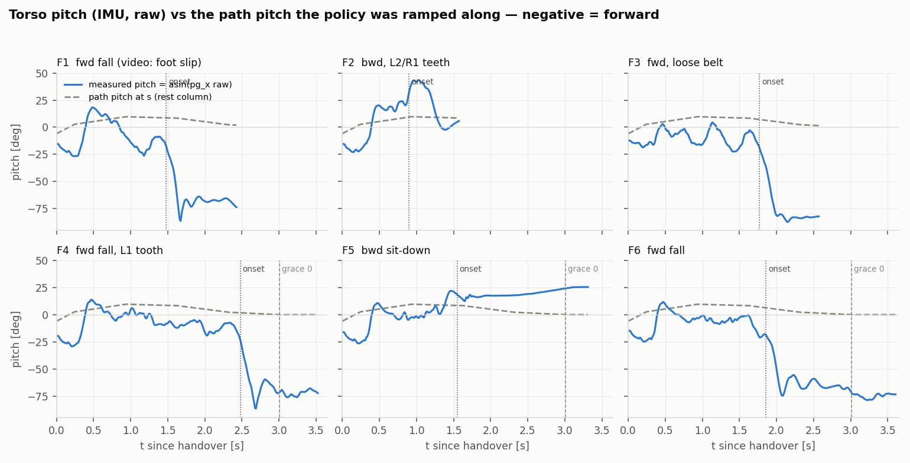
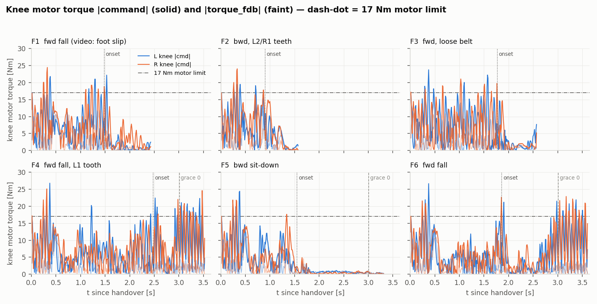
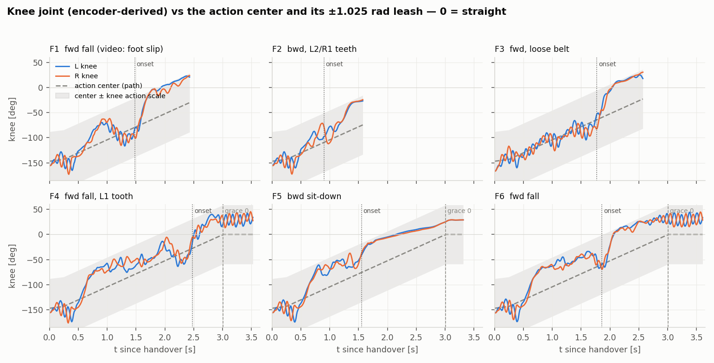
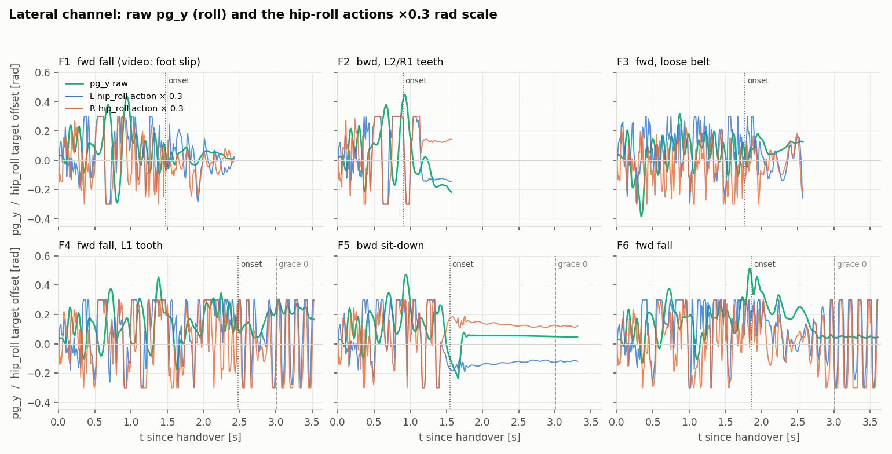

# S8b stand-up flight analysis — 2026-10-03

**Date:** 2026-10-03
**Policy:** `control/s8b_8880.pt` (S8b, `model_8880`, policy_iter 8880 stamped in every npz)
**Data:** `data/s8b_standup_flight_20261003/` (6 trials, one policy, one difficulty)
**As-run deploy scripts:** the frozen `balance_standup.py` / `standup_path.py` / `config.py` /
`policy.py` copies in that folder. They are byte-identical to the repo at commit `04c533a`
("Flight standup alpha0.6"), and the Pi clone sat on that commit with no local edits.
**Sim side:** `RL/logs/rsl_rl/p9_replant/2026-09-19_08-14-51_S8b_air03/params/env.yaml`
(`standup_ramp_mode: path`, `standup_grace_seconds: 5.0`, `action_lpf_alpha: 0.6`,
`handover_prime_prob: 0.0`, `standup_path_spawn_clearance_m: 0.006`).
**Figures:** `docs/figs/standup-flight-20261003/fig1..fig4`.
**Analysis scripts:** `data/s8b_standup_flight_20261003/_summary.py`, `_detail.py`,
`_onset.py`, `_skipsig.py`, `_figs.py` (run with `python`).

## Question

First hardware stand-up with the path-mode deploy stack: six trials from d = 0.6 (s0 = 0.4,
the K1 crouch with knees and foot balls down), blind `v` handover, 300-step (3 s) grace.
Flights 1–3 fell before the knees were half extended; flights 4–6 stood to a crouch and fell
from it. Between trials the user re-shimmed the knee pulleys, added anti-slip to the shins and
feet, and tightened the belt twice. The user's frame-by-frame video calls are ground truth:
flight 1 was a **foot slip**; flights 2–6 ended with **belt tooth skips** measured in the
post-trial crawl pose (1 tooth = 12° of knee).

Four claims from the user's flight notes are tested as pre-registered hypotheses:

1. **H1 — the falls are caused by shuffling plus tooth skipping.**
2. **H2 — the 3 s path is too slow:** the policy is nearly up by 0.8 s and the 0.8–3 s
   segment is wasted shuffling.
3. **H3 — the sim2real gap is small.**
4. **H4 — the tooth skipping is a torque problem at the mechanical level**, i.e. stand-up loads
   the belt past what the pulleys hold.

Plus the standing conditions: the deploy contract matched training, and the stand-up timeline in
the npz matches the user's floor observations.

## Data and logging contract

Every tick of every npz is `mode = NN_CONTROL`: the log starts at the `v` edge, so there is
no HOLD or OBSERVE segment hidden in any file. A correction from the user applies to the
tails: the logs of flights 4–6 run 0.3–0.6 s past grace expiry **only because the `h` key was
pressed late**. The robot had already fallen; see the onset column below.

| item | value in all six trials |
|---|---|
| handover | `blind` (`v`), zeroed obs history, last_action 0 |
| difficulty / s0 / grace | 0.6 / 0.400 / 300 steps assigned, `MAX_GRACE_STEPS` 500 |
| init_h (obs ch 31) | 0.203 |
| imu_pg_offset | (−0.015, 0.0) |
| kp / kd (joint side) | 6/20/30, 0.3/1.4/1.5 |
| action LPF alpha | 0.6 on the action, bridge LPF 0 |
| knot table | 14 knots, identical to env.yaml (desk-checked 10-02) |

Obs z-scores against the normalizer (pre-fall ticks only): max |z| is 7.4–7.6 on a knee
position channel in every trial, because the lift-off rocks the knee to −3.0 rad while the
running normalizer is dominated by standing poses. The per-group maxima are the same to two
decimals across all six files, so no channel behaved differently between the trials; the
contract did not drift.

## Timeline per trial

Onset = first time |measured pitch − path pitch| exceeds 25° and never comes back.
"Measured pitch" = asin(raw pg_x), negative = forward. End state = raw pg_x of the last tick.

| flight | file (HHMMSS) | log dur | onset | direction | end pg_x | knee at 0.8 s (L/R, deg) | post-trial crawl knee (L/R, deg) | user notes |
|---|---|---|---|---|---|---|---|---|
| 1 | 103129 | 2.43 s | 1.48 s | forward | −0.96 | −81 / −85 | +14.3 / −13.3 → re-zeroed to −11.3 / +11.4, no skip | foot slipped (video) |
| 2 | 114235 | 1.57 s | ~0.9 s | backward | +0.10 (peak +0.69) | −103 / −86 | +24.5 / −0.7 → L 2 teeth, R 1 | pulley shim changed, shin anti-slip added |
| 3 | 115546 | 2.57 s | 1.77 s | forward | −0.99 | −103 / −106 | +36.6 / −25.0 → L ~4, R ~3 teeth | belt loose |
| 4 | 120707 | 3.52 s | 2.48 s | forward | −0.95 | −70 / −72 | +1.4 / +11.5 → L 1 tooth | belt tightened; "almost stood" |
| 5 | 122513 | 3.31 s | 1.55 s | backward (sat down) | +0.43 | −61 / −69 | −0.3 / +10.9 → L 1 tooth* | belt tightest |
| 6 | 123247 | 3.60 s | 1.86 s | forward | −0.96 | −68 / −65 | +1.6 / +10.2 → L 1 tooth* | same as 5 |

\* Whether flights 5 and 6 skipped a *new* tooth depends on whether `setzero_crawl.py` was
re-run after flight 4. The encoder symmetry at t = 0 cannot tell: HOLD servos the motors to a
symmetric target regardless of where the belt sits. Please confirm.

The user's floor clock agrees with the npz: 2.4 s for flight 4 (npz 2.48), 1.78 s for flight 5
(npz: the pitch flips backward at 1.45–1.55 s and the robot is seated by 1.8 s).

## Findings

### 1. The HOLD pose is 9° deeper at the hip than sim: the knee belt pushes back on the hip

**What is measured.** At t = 0 (the pose HOLD settled into before the `v` edge, HOLD target
hip 1.321 / knee −2.562 = path knot K8, s = 0.4) the hip reads 1.410–1.426 rad on both legs in
flights 1, 2, 4, 5, 6. The same knot in sim (`script/show_standup_path.py`, K8, training gains)
settles at hip 1.257, knee −2.704, raw pitch −5.5°. The knee is the same on both sides
(hardware −2.695…−2.727), so the thigh sits the same way; the hip is +0.16 rad (+9.4°) deeper,
and the raw torso pitch is −14.7…−16.0° (flight 4: −19.5°), about 10° more forward than sim.
The IMU and the hip encoder agree on that extra tilt. Flight 3 had a different HOLD target
(1.445 / −2.728) and is compared against its own target below, not against K8.

**What it means.** In a still crouch each hip settles where its PD torque,
kp_hip·(target − q) with kp_hip = 20, cancels every other torque on the hip joint.

- Sim: q sits 0.064 rad *short* of the target, so the PD supplies +1.28 Nm, holding the
  torso's gravity moment, which pulls toward a shallower hip.
- Hardware: q sits 0.10 rad *past* the target, so the PD supplies −2.0 Nm, pushing the other way.

So each hardware hip carries about 3.3 Nm toward deeper flexion that sim does not have.

**Cause: the J^T reaction of the knee belt drive.** The knee motor's stator is bolted to the
hip chassis, and it drives the knee through the belt, so its motor angle is
m = (q_knee + c·q_hip)/G (c = 0.733, `motor_bridge.py`). By virtual work, the motor torque
loads *both* joints: τ_knee on the knee and **c·τ_knee on the hip**. In the crouch the knee
holds 4.0–5.2 Nm against the floor, so each hip gets 2.9–3.8 Nm toward deeper flexion. Neither
side models it: S8b trained with `hip_reaction: false` (env.yaml), and the deploy has
`HIP_REACTION_FF = False` (`control/config.py`). The earlier reading here, "the gravity
moment has the opposite sign", was wrong: a 10° torso tilt changes the gravity moment by only
about 0.3 Nm per leg, and producing 3.3 Nm from gravity alone would need the upper-body CoM
to move about 17 cm.

**Test** (pre-registered, nothing fitted to the flight data). If the belt reaction is the whole
offset, each hip settles at hold + (c·τ_knee − τ_g)/kp_hip. Here τ_knee = 30·(knee hold − q_knee)
is the knee PD torque at t = 0, and τ_g = 1.28 Nm is the gravity-holding torque from the sim
K8 print (sign mirrored on leg 2).

| flight | hold hip (L) | τ_knee L / R (Nm) | c·τ_knee L / R (Nm) | L pred / meas | R pred / meas |
|---|---|---|---|---|---|
| 1 | 1.321 | 4.30 / 4.57 | 3.15 / 3.35 | 1.415 / 1.421 | −1.425 / −1.421 |
| 2 | 1.321 | 3.99 / 4.62 | 2.93 / 3.39 | 1.403 / 1.410 | −1.426 / −1.417 |
| 3 | 1.445 | 5.21 / 5.21 | 3.82 / 3.82 | 1.572 / 1.572 | −1.564 / −1.564 |
| 4 | 1.321 | 4.38 / 4.57 | 3.21 / 3.35 | 1.418 / 1.426 | −1.425 / −1.414 |
| 5 | 1.321 | 4.50 / 4.58 | 3.30 / 3.36 | 1.422 / 1.418 | −1.425 / −1.418 |
| 6 | 1.321 | 4.68 / 4.94 | 3.43 / 3.62 | 1.429 / 1.423 | −1.438 / −1.426 |

**Verdict: supported.** All 12 legs fall within 0.013 rad (< 0.8°) of the prediction,
including flight 3, which had a different target and a larger knee load. The null model (no
reaction, i.e. the sim) predicts 1.257 and misses by 0.16 rad on every leg. Alternatives:

- **Hip zero offset: contradicted.** It would not change the commanded PD torque, and the IMU
  confirms the extra tilt independently.
- **CoM error: contradicted.** It would need a 17 cm shift.
- **Hip stiction: unlikely.** It would need about 3 Nm of friction (bench: 0.15 Nm) that
  repeats to the hundredth of a radian across separately placed trials.

**Consequences.**

1. This reopens the 08-06 conclusion that "the real hip does not feel the J^T reaction" (the
   dynamic teacher-forcing replay quoted in `config.py` and `belt_knee_actuator.py`). A
   still crouch is the cleaner test of a static force, and here the full reaction is present.
2. The reaction scales with knee torque. Every newton-metre of knee extension effort pitches
   the torso forward through the hip by 0.73 Nm. At the lift-off rock (finding 2) the knee
   sits at the 23.2 Nm joint clamp, which puts up to ~17 Nm on each hip. That is the hip
   motor's whole budget, and sim never trained against it. Candidate contributor to the
   lift-off loads and forward falls; **not tested**.
3. The policy inherits this offset on frame 1 of every trial: a pose ~10° more forward than
   any sim episode began from.

**Sim knob.** `env.plant_hip_reaction=true` (`rl_env_cfg_p6.py`, default false = the S8b plant)
switches on `BeltKneeDCMotorCfg.hip_reaction`, now applied as a post-clip plant force. The pose
viewer has the same term: `run_show_standup_path.ps1 -HipReaction` or the window toggle.
Acceptance check: K8 under training gains with the reaction on should settle at hip ≈ 1.42 and
raw pitch ≈ −15°, knee unchanged. Bench check (user runs it): hold the crouch, step only the knee
target, and the hip should move Δq_hip ≈ c/kp_hip = 0.037 rad per Nm of knee-torque change.

### 2. Lift-off is a knee-limited rock that loads both belts past the motor clamp

In every flight the knee first *flexes* from −155° to −165…−176° at 0.28–0.39 s (pinned near
the −3.06 rad limit, the "dynamic rock" of the path-mode notes), then extends at 12–16 rad/s to
reach −60…−105° by 0.8 s. During [0.23–0.39 s] the knee motor command peaks at 22–27 Nm on
**both** legs in all six flights, above the 17 Nm motor limit (23.2 Nm joint side).
`torque_fdb` peaks at 11–14 Nm, but that channel carries the known 25–35 ms filter and reads
low on transients (memory: motor-telemetry-not-plant), so the true delivered peak is the clamp.
Hip commands also touch 17–21 Nm in the same window.

Outside this window the knee command crosses 17 Nm before the fall only in 1–3-tick blips
(flights 4, 5, 6) or in the final 0.3 s before onset (flights 1, 3). The belt is therefore
loaded hardest at the lift-off rock, when the shin and foot ball are both pushing on the floor.

### 3. The "shuffle" is the knee riding the top of its action leash

From 0.8 s the policy holds the knee 40–60° *ahead* of the moving action center. The knee
action scale is 1.025 rad = 58.7°, so this is the leash. In [0.8, 1.6 s] the knee action mean
is +0.65 to +0.79 on both legs with 20–43 % of ticks clipped at |a| > 0.95 (flights 4–6); the
hip action is clipped 20–70 % of ticks in various windows. The policy wants a shallower crouch
than the ramp allows, and the only way it can express that is to saturate. Meanwhile the
torso pitch tracks the path within ±10° (flights 4 and 6, 0.8–1.6 s): the policy is balancing
fine, it is just being held in a deep crouch it did not choose.

Knee joint velocity RMS drops from 6 rad/s (lift-off) to 2.5–3.7 rad/s (shuffle), hip to
2.2–3.0 rad/s — the waiting phase is not quiet. Both legs oscillate at 2–3 Hz around the leash
edge (fig 2).

A structural fact behind this: in path mode `grace_norm = 1 − s` at every tick for every d, and
`ds/dt = 1 / (STANDUP_GRACE_SECONDS · 100 Hz) = 0.2 s⁻¹` regardless of d. The policy has never
seen the center move faster than a full traversal in 5 s. Re-knotting the table so the K1
crouch becomes s = 0 ("alpha 0.6 is the new alpha 1") would *not* by itself speed anything up;
the speed is set by `STANDUP_GRACE_SECONDS` alone.

### 4. Fall mechanics at onset

**Forward falls (1, 3, 4, 6).** In the 0.2 s after onset, gyro_y runs −3 to −7 rad/s while
both knees *extend* at 4–8 rad/s from the crouch to straight and past it, with knee torque
under 6 Nm. The torso topples over the feet and the legs straighten under it; the policy
commands full knee extension (+1.0 clipped, 90–100 % of ticks) once the pitch passes −50°.
Nothing in the npz distinguishes a foot slipping backward (flight 1, video) from a pure
balance loss; the signature is the same. After the fall all four end with both knees reading
**+17° to +40° past straight** while the policy commands +30° to +57°. If the physical knee
stop is near 0°, those readings are belt teeth skipping *against the stop* after the fall, and
the post-trial crawl counts overstate the in-flight skips. The user knows the physical knee
range; this is flagged, not concluded.

**Backward (5).** Pitch flips to +18…+22° at 1.45–1.55 s and stays; hips go to 72–79°
flexion, knees straighten to −6…−16° by 1.95 s, knee torque falls to under 1 Nm. That is a
sit-down on the floor with the legs out in front. From 1.6 s the hip action sits at **+1.00 on
100 % of ticks**: the 0.75 rad hip leash is binding during the attempted backward recovery
exactly as the knee leash binds during the shuffle. Flight 2 also went backward (+0.69 peak)
before `h`, with the knee already 2 teeth off.

### 5. In-flight tooth skip: no direct signature, one indirect one

Direct: no knee velocity sample exceeds 20 rad/s in any file (a skip under load should
transient the motor), so the npz does not time-stamp the skips. `sim_joint_pos` is motor-side
derived and cannot see them by construction.

Indirect, the crouch window [1.0 s, onset):

| flight | mean raw pg_y | L / R hip_roll action mean | post-trial skip |
|---|---|---|---|
| 1 | +0.060 | +0.27 / −0.05 | none (foot slip) |
| 3 | +0.061 | +0.29 / −0.20 | ~4 / ~3 teeth, both legs |
| 4 | +0.150 | +0.55 / +0.12 | L 1 |
| 5 | +0.126 | +0.14 / +0.18 | L 1 (*) |
| 6 | +0.176 | +0.53 / +0.01 | L 1 (*) |

The three flights that ended with a one-sided left-knee offset carried a 2–3× larger lateral
lean and a 2× larger left hip-roll correction through the crouch than the flight with no skip
and the flight with a near-symmetric multi-tooth skip. That is what a 12° left-knee geometry
error, invisible to the policy, would produce — and it implies the skip happened **before**
the crouch, i.e. at the lift-off rock of finding 2. Five trials is thin, so: supported, weakly.

### 6. Belt tension shows up in the lift-off, not the crouch

Flight 3 (loose belt) rested 11° deeper at the knee and 8.5° deeper at the hip in HOLD, but
its HOLD *target* was also deeper (1.445 / −2.728 vs 1.321 / −2.562). The target accounts for
9.5° of the knee and 7.1° of the hip, and the belt reaction of finding 1 accounts for the rest
of the hip to 0.0002 rad. So the deeper rest is not a belt-tension signature. Its knees reached
only −103/−106° by 0.8 s against −60…−72° for the tightened flights 4–6. That is consistent with
"tighter belt → faster lift-off", but it is confounded by the deeper start pose. The visible shaking during the
stand (user observation 2) is the 2–3 Hz leash-edge oscillation of finding 3, present at every
tension; the npz cannot separate belt compliance from policy dither at that frequency.

### 7. Sim comparison

There is no sim rollout log to compare against: `play_alpha.py` (the `-Alpha 0.6 -SettleS 1`
viewer) has no npz writer, and the only sim artifacts are the mp4s under the run's
`videos/play/`. H3 is tested here only through what the hardware npz can say on its own:

- the frame-1 pose is 9° off the sim rest at the hip (finding 1). This is a measured gap with
  an identified cause, the unmodeled c·τ_knee belt reaction on the hip, now available in sim as
  `env.plant_hip_reaction`;
- the policy saturates its knee leash for a third of the shuffle and its hip leash for all of
  a backward recovery (findings 3, 4) — not measurable in sim without a log;
- the user reports that lowering sim friction reproduces the hardware look, and that the shin
  rests on the floor at alpha 0.6 in sim as it does on the rig.

## Verdicts

| hypothesis | verdict | discriminating signal |
|---|---|---|
| H1 shuffling + tooth skip causes the falls | **supported** (skip timing indirect) | all onsets fall inside the leash-saturated crouch, 1.5–2.5 s; the only pre-fall window with knee demand above the motor clamp is the lift-off rock on every flight; crouch roll bias 2–3× larger in the one-sided-skip flights |
| H2 the 3 s path is too slow, 0.8–3 s is wasted | **supported** | knee 40–60° ahead of the center from 0.8 s, 20–43 % of knee ticks clipped, mean knee action +0.65…+0.79; pitch tracks the path within ±10° while waiting |
| H3 sim2real gap is small | **inconclusive** | no sim log exists; the one measured gap (hip rest +9°, torso ~10° forward on frame 1) is not small for a balance pose and is explained to 0.013 rad by the unmodeled belt reaction c·τ_knee on the hip (finding 1); the leash saturation needs a sim twin to compare |
| finding 1: HOLD hip offset = belt reaction c·τ_knee | **supported** | predicted hip angle from hold target + c·τ_knee/kp_hip matches 12/12 legs within 0.013 rad, incl. flight 3's different target; gravity / zero-offset / stiction alternatives contradicted or unlikely |
| H4 stand-up torque exceeds what the belt holds | **supported** | knee motor command 22–27 Nm on both legs at 0.23–0.39 s in all six flights, above the 17 Nm clamp; the skips are counted after every flight that passed the rock |
| flight 1 = foot slip (video) | consistent, not discriminable | forward-fall npz signature identical to flights 3, 4, 6 |
| contract matched training | **supported** | blind handover, grace 300/500, knot table, trim, LPF and gains all stamped in the npz and equal to env.yaml |

## What this says about the user's three proposals

**Mechanics first.** H4 is supported in every trial: the stand-up asks both knee motors for more
than the clamp at the rock, and the belt is the element that gives. The data cannot choose the
fix (steel-core belt, metal pulleys, idler, larger pulley wrap), only confirm the load case: the
peak is simultaneous on both knees at 0.25–0.4 s with the shin on the floor, and a second
sustained clamp-level demand appears after any forward fall (knees pushing against the floor
and the stop), which is where unmonitored skips may accumulate. Until then, no stand-up trial is
a clean read on the policy after 0.4 s.

**Path speed.** Supported, but the cheap version is not a table re-knot. Three ways to make
0.8 s the stand-up, with difficulty predicted before anyone builds:

1. *Deploy-side clock multiplier k* (center and `grace_norm` advance k× faster; `grace_norm`
   stays `1 − s`). Common: time-warping a scripted phase variable is standard in
   trajectory-tracking RL. Cost: one flag in `standup_path.py` + the same flag in
   `play_alpha.py` so it is tested in sim first, ≈1 h. Risk: the policy never saw a faster
   center; with a 50 ms history it barely observes the rate, so k = 1.5, 2, 3 is a sim sweep
   away. Cheapest, no new checkpoint, keeps the handover contract.
2. *Train with traversal-speed randomization* (a DR band on the per-episode grace multiplier).
   Moderate: one knob + a resume from 8880 with every S8b override re-passed, GPU-days.
   Makes the policy rate-agnostic so option 1 stops being an extrapolation.
3. *Re-knot so K1 is s = 0 and set `STANDUP_GRACE_SECONDS` ≈ 2*. Expensive: new curriculum
   semantics for `grace_norm`, new checkpoint, the SIT plan's reverse-path argument has to be
   re-derived. Only worth it if 1 and 2 fail.

Also note the hip leash: flight 5 shows the 0.75 rad hip scale binding during a backward
recovery. If option 2 is built, it is the moment to re-ask whether the hip scale should widen;
not before.

**Sim2real gap.** Not measurable today. The 1-hour fix is to port the `play_sim2real.py` autolog
(simlog npz) into `play_alpha.py` so an alpha-0.6 settle-then-fly rollout can be laid over fig 2.
That one log answers whether the sim policy also rides the leash edge from 0.8 s (then H2 is a
training-design fact, not a gap) or stands calmly ahead of the center (then the hardware
struggle is plant).

## Next steps, in order

1. Mechanical: belt/pulley upgrade; confirm the physical knee range past 0° (finding 4) and
   whether `setzero_crawl.py` ran between flights 4, 5, 6 (timeline footnote).
2. Belt hip reaction (finding 1): confirm in the pose viewer (`-HipReaction`, K8 → hip ≈ 1.42,
   pitch ≈ −15°) and on the bench (knee-target step, 0.037 rad of hip per Nm). Then rerun the
   S8b alpha-0.6 sim rollout with `env.plant_hip_reaction=true` to see whether the policy, never
   trained against it, still lifts off. Whether to train with it is a separate decision.
3. `play_alpha.py` npz logger (sim twin of fig 2), then the k-multiplier sweep in sim.
4. If k ≥ 2 stands cleanly in sim: add the deploy flag and fly it under the same `v` contract
   and trim, with the crawl-pose check between every trial as now.
5. Record the trial LED in the video frame so the next report can anchor onset on a physical
   event instead of the pitch criterion.
