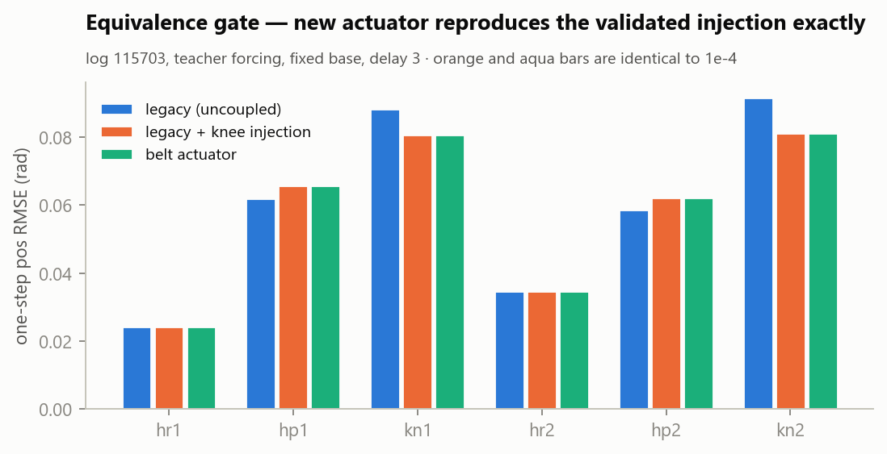
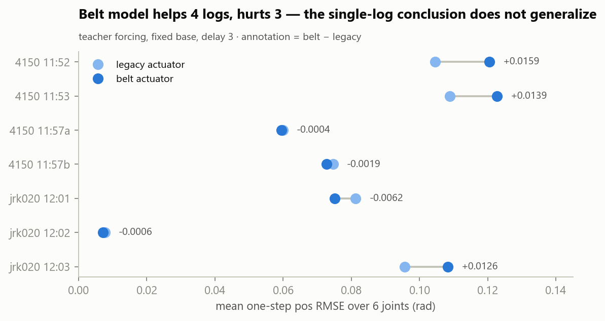
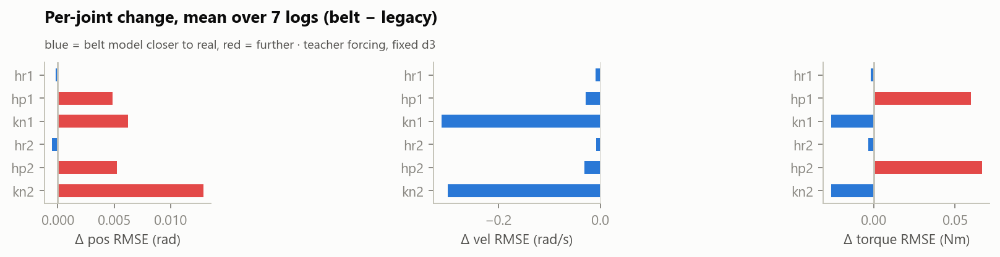
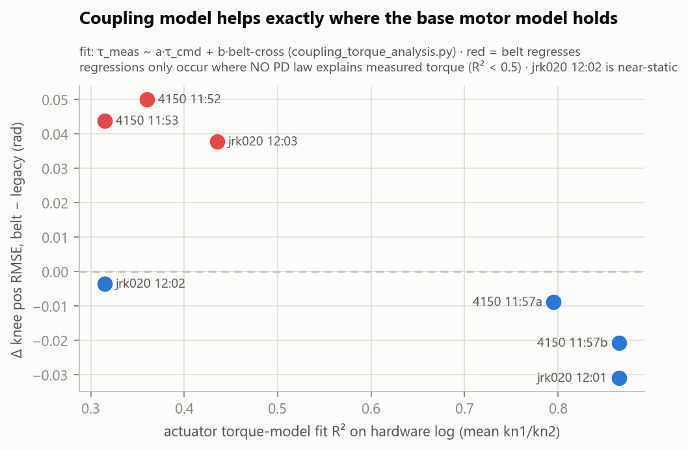
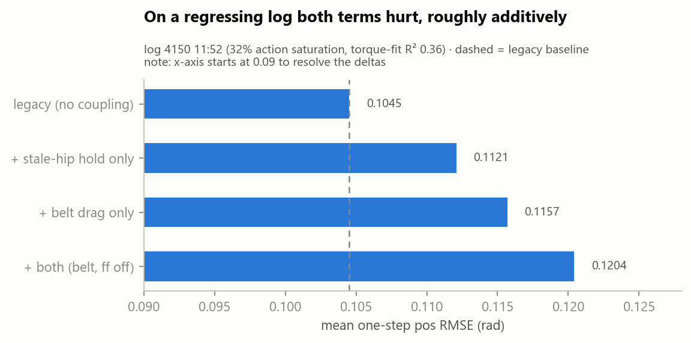
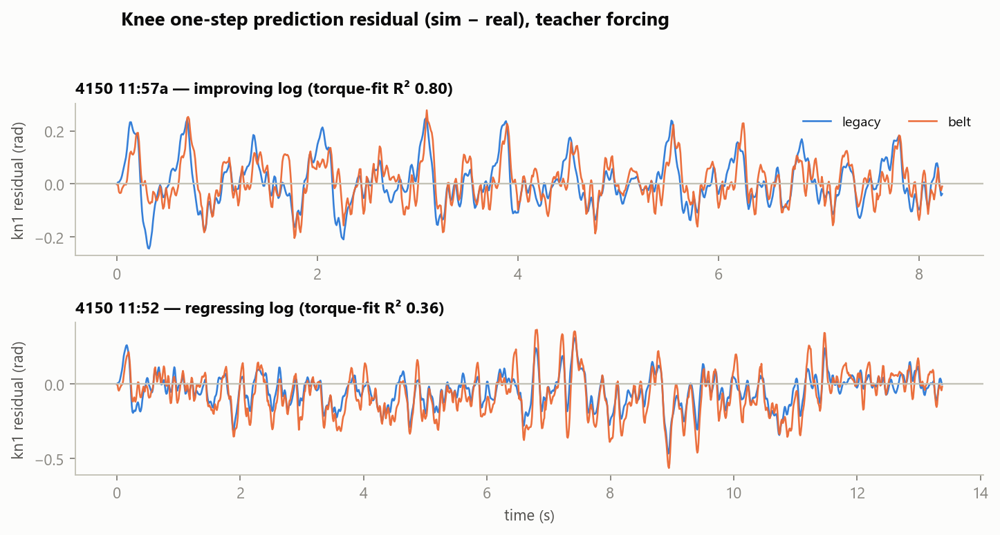

# Knee Belt-Coupling Sim2Real — Evaluation Report

**Date:** 2026-08-07 · **Scope:** modeling the knee belt drivetrain in Isaac Lab and measuring whether it closes the sim2real gap, using teacher-forcing replay of 7 hardware logs as the metric. Baseline = the pre-belt training model ("legacy").

## TL;DR

1. **A sim-side "firmware replica" belt actuator was implemented and is provably correct** — it reproduces the previously validated coupling-injection experiment per-joint to 1e-4.
2. **The 2026-08-06 single-log conclusion does not generalize**: across the 7-log corpus the coupling model improves 4 logs and regresses 3. Knee *velocity* and *torque* RMSE improve consistently on well-behaved logs; knee *position* RMSE is bimodal.
3. **The discriminator is the base motor model, not the coupling**: regressions occur exactly on the logs where *no* PD law explains the measured torque at all (torque-fit R² 0.23–0.45, the 32%-action-saturation runs). Where the motor model holds (R² ≥ 0.75), the coupling model helps everywhere.
4. **Recommendation: do not retrain yet.** The dominant remaining gap is unmodeled high-saturation actuator behavior (firmware current limiting / belt slip under load). Chase that first; the belt actuator is ready and waiting in the training cfg for when the plant model is trustworthy in that regime.

## 1. Background

The knee motor sits on the hip chassis and drives the knee through a 22:30 belt, so the knee joint is kinematically coupled to hip pitch: `q_knee = sign·G·θ_motor − c·q_hip` (G = 22/30, c = 0.733). The training sim modeled a rigid direct-drive knee with pre-multiplied scalars only. Hardware-side consequences measured on 2026-08-06:

- the firmware knee Kd fights belt-forced motor spin (~30 % of knee command RMS) → patched live with the `KNEE_DECOUPLE_FF` v_des feedforward;
- the knee motor target bakes in the hip position measured at send time and firmware holds it all tick ("stale-hip" phantom error);
- the ideal J^T hip-reaction term `c·τ_knee` was **refuted** (injecting it made the hip match worse).

## 2. What was implemented

| Piece | File |
|---|---|
| `BeltKneeDCMotor` + cfg — motor-space knee PD (belt drag), stale-hip latch, motor-velocity torque envelope, `hip_reaction` flag (off), `knee_decouple_ff` flag | [belt_knee_actuator.py](../../RL/source/RL/RL/tasks/direct/standup_curriculum/belt_knee_actuator.py) |
| Merged `hip_knee` actuator group is now the training default; legacy model kept as `make_legacy_actuators()`; hip-pitch armature 8.4e-3 (own 4.2e-3 + reflected knee rotor c²·7.81e-3) | [rl_env_cfg_p6.py](../../RL/source/RL/RL/tasks/direct/standup_curriculum/rl_env_cfg_p6.py) |
| Group-layout-agnostic DR / diagnostics (verified: env boots, 25 steps, per-env DR reaches the merged actuator) | [rl_env_p6.py](../../RL/source/RL/RL/tasks/direct/standup_curriculum/rl_env_p6.py) |
| Replay A/B flags `--actuator legacy\|belt`, `--knee-ff on\|off`, stale-hip / hip-reaction / armature ablations, torque-RMSE metric (vs `tau_meas`, best lag 0–2) | [sysid_replay_policy_log.py](../../data/sysid_replay_policy_log.py) |
| Batch driver + aggregation over the 7-log corpus | [replay_sweep.py](../../data/replay_sweep.py) |

## 3. Method

**Metric:** teacher-forcing replay — sim is reset to the logged state every 10 ms control tick and predicts one step ahead; per-joint one-step position / velocity / torque RMSE (warmup excluded). This isolates local model error from open-loop divergence. All comparisons at the same cell (fixed base, action delay 3 — the best cell for every run).

**Corpus:** the 7 hang logs of 2026-08-06 (4 × `model_4150`, 3 × `jrk020_grf13`). All predate the `KNEE_DECOUPLE_FF` firmware patch, so the belt variant replays them with `--knee-ff off` (modeling the firmware that actually ran).

## 4. Results

### 4.1 Equivalence gate — the actuator class is correct

Belt actuator (legacy armature, ff off) vs the already-validated per-substep torque injection, on log 115703:



| variant | hr1 | hp1 | kn1 | hr2 | hp2 | kn2 | mean |
|---|---|---|---|---|---|---|---|
| legacy (uncoupled) | 0.0244 | 0.0619 | 0.0884 | 0.0347 | 0.0586 | 0.0916 | 0.0599 |
| legacy + knee injection | 0.0243 | 0.0657 | 0.0806 | 0.0346 | 0.0622 | 0.0812 | 0.0581 |
| belt actuator | 0.0243 | 0.0657 | 0.0806 | 0.0346 | 0.0622 | 0.0812 | 0.0581 |

The injection row and the belt row are identical to 1e-4 — the new class implements exactly the physics the earlier experiment validated. (Replay self-check also passes: pass-to-pass jitter 6.4e-4 rad, below the 1e-3 bar.)

### 4.2 Corpus sweep — the improvement is not uniform





Mean over the 7 logs (best cell per log):

| metric (mean over joints) | legacy | belt | Δ | belt_arm42 |
|---|---|---|---|---|
| pos RMSE (rad) | 0.0761 | 0.0809 | +0.0047 (median-over-logs −0.0004) | 0.0815 |
| vel RMSE (rad/s) | 2.574 | 2.460 | −0.115 | 2.541 |
| torque RMSE (Nm) | 0.963 | 0.974 | +0.011 | 0.969 |

Knee velocity RMSE improves strongly and consistently on the active good logs (kn −0.7…−0.85 rad/s), knee torque RMSE improves (−0.026 Nm mean); knee position is bimodal (−0.005…−0.049 on improving logs, +0.036…+0.055 on regressing logs). Hip pitch position degrades mildly (+0.005) — an indirect effect through the changed knee torques acting on the chain, echoing the earlier finding that the real hip is more decoupled from the knee than rigid-body physics predicts.

### 4.3 The headline finding — what separates the two groups



The regressing logs are exactly the logs where the hardware-side torque decomposition (`coupling_torque_analysis.py`: `τ_meas ~ a·τ_cmd + b·cross`) fails — R² 0.23–0.45, best-fit lag stretched to 3–4 ticks, 32 % action saturation. On those runs **no PD law explains the measured torque**; adding correct coupling terms to an already-wrong torque model adds variance instead of accuracy. Where the motor model holds (R² 0.75–0.89), the coupling model helps every time.

### 4.4 Term ablation on a regressing log



Both the belt-drag and the stale-hip term hurt on log 11:52, roughly additively — consistent with "the base torque model is wrong there," not with one specific coupling term being mistaken.

### 4.5 Residual traces



On the improving log the belt model visibly removes the structured early-transient residual; on the regressing log the belt residual grows in the high-activity segments (t ≈ 6–11 s) where saturation is heavy.

### 4.6 Hip-armature reflection (8.4e-3 vs 4.2e-3)

Position: statistically indistinguishable on this corpus (hp identical to 1e-4 in the aggregate; single logs disagree in both directions). Velocity: 8.4e-3 clearly better (mean 2.460 vs 2.541 rad/s; hip vel −0.03 vs +0.08 against legacy). **Kept 8.4e-3** as the default — it is also the physically derived value.

## 5. Interpretation & recommendation

The coupling physics is real and now correctly modeled — that part is settled by the equivalence gate and by the consistent knee velocity/torque gains. What the corpus adds is a boundary of validity: **the belt terms only pay off where the underlying DC-motor + friction model itself explains the hardware torque.** In the violent, 30 %-saturation regime something unmodeled dominates (candidates: firmware current limiting, belt slip/backlash under load, thermal derating), and no amount of coupling modeling fixes that.

Therefore:

1. **Hold the retrain.** Training against the belt plant now would bake the model in precisely where it is least trustworthy (aggressive motions — the regime a standing/walking policy visits under disturbance).
2. **Next investigation: high-saturation torque behavior.** Concrete first step: a bench test with a locked joint, stepping commands deep into saturation while logging `tau_meas`, to separate current-limiting (torque plateaus at a current-dependent cap) from belt slip (position slips, torque collapses). Alternatively re-run `firmware_pd_replica.py` restricted to high-|action| segments to quantify the R² collapse against saturation fraction.
3. **Keep the hardware `KNEE_DECOUPLE_FF` on** — it remains validated. The belt cfg's `knee_decouple_ff=True` default models exactly that deployed plant for the eventual retrain.
4. When retraining, re-run this sweep first on any post-patch logs (with `--knee-ff on`) to refresh the baseline.

## 6. Reproduction

```powershell
conda activate env_isaaclab            # must be cmd/PowerShell activation (sets kit PYTHONPATH)
# full sweep + aggregate tables:
python -u data\replay_sweep.py --variants legacy,belt,belt_arm42 --delays 1,2,3 --base fixed --skip-existing
# single-run A/B example:
python -u data\sysid_replay_policy_log.py --npz control\model_4150_log_20260806_115703.npz `
    --base fixed --delays 3 --teacher-forcing --actuator belt --knee-ff off --headless
# regenerate the figures in this report (plain python, no Isaac):
python reports\belt_coupling_sim2real\make_figs.py
```

Artifacts: per-run results `control/*_simreplay_{legacy,belt_ffoff,belt_ffoff_arm0.0042}_tf.{json,npz,pdf}`, aggregate `control/_sweep_aggregate.json`, run logs `control/_sweep_*.log`, ablations `control/_abl_{dragonly,staleonly}.log`, equivalence runs `control/_eq_{legacy,belt_arm42}.log`. Figures regenerate deterministically from these via [make_figs.py](make_figs.py).
